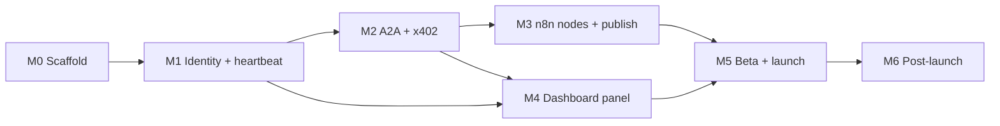

# Zynd n8n Integration — Milestone Phases

A task-level breakdown of the [Rollout Plan](ROLLOUT.md#milestones). Every task links back to the PRD, HLD, LLD and Architecture sections it implements, so you can jump from "what to build this week" to "what it has to look like".

## How to read this

- **Task IDs** (`M2.6`) are stable. Use them in tickets, PR titles and stand-ups.
- **Refs** link to the section that defines the task. The bold text after a link names the exact row, bullet or step inside that section.
- **Done when** is the acceptance check for the task. A milestone is finished when every task is done and its **Exit gate** passes.
- **⚠ G#** marks a task blocked or affected by a gap or contradiction in the docs. See [Open design questions](#open-design-questions).
- **Priority** comes from the PRD: [P0](PRD.md#p0--must-have-for-launch), [P1](PRD.md#p1--should-have), [P2](PRD.md#p2--nice-to-have).

| Doc | What it holds |
| --- | --- |
| [PRD](PRD.md) | Problem, personas, P0/P1/P2 requirements, NFRs, success metrics, assumptions |
| [Architecture](ARCHITECTURE.md) | Why "Thin Node + Gateway", feature lists per component, trust model |
| [HLD](HLD.md) | Components, the five data flows, security layers, infrastructure |
| [LLD](LLD.md) | Files, operations, service methods, dashboard routes, DB schema, error codes |
| [Rollout](ROLLOUT.md) | Milestones, risks, launch checklists |

---

## Phase overview

| Phase | Week | Goal | Exit gate | Main refs |
| --- | --- | --- | --- | --- |
| [M0 — Scaffold](#m0--scaffold-week-1) | 1 | Both repos, schema, CI and scanner in place; low-footprint stack (Drizzle, bundled build); assumptions checked | Both repos build green, scanner runs in CI | [LLD › File Layout](LLD.md#file-layout), [LLD › Module Layout](LLD.md#module-layout), [LLD › Database Schema](LLD.md#database-schema) |
| [M1 — Identity + heartbeat](#m1--identity--heartbeat-week-2) | 2 | Gateway can derive keys, register an agent and keep it alive | Agent registered and heartbeat visible in search | [HLD › Data Flows (3)](HLD.md#data-flows), [LLD › IdentityService](LLD.md#identityservice), [LLD › HeartbeatManager](LLD.md#heartbeatmanager) |
| [M2 — A2A + x402](#m2--a2a--x402-week-3) | 3 | Gateway serves n8n, inbound A2A and outbound paid calls | One paid call completes through Gateway to n8n and back | [HLD › Data Flows (1, 2, 4, 5)](HLD.md#data-flows), [LLD › A2AHandler](LLD.md#a2ahandler), [LLD › PaymentProcessor](LLD.md#paymentprocessor) |
| [M3 — n8n nodes + publish](#m3--n8n-nodes--publish-week-4) | 4 | Verified-ready npm package published | Package on npm, scanner passes, Creator Portal submission filed | [LLD › n8n Package](LLD.md#n8n-package--n8n-nodes-zynd), [Architecture › n8n Node Features](ARCHITECTURE.md#n8n-node-features) |
| [M4 — Dashboard panel](#m4--dashboard-panel-week-5) | 5 | Developers self-serve listings and keys | Developer can create a listing, generate a key and see the agent go live | [LLD › Dashboard — n8n Panel](LLD.md#dashboard--n8n-panel), [Architecture › Dashboard Panel Features](ARCHITECTURE.md#dashboard-panel-features) |
| [M5 — Beta + launch](#m5--beta--launch-week-6) | 6 | Harden, onboard beta builders, launch | All beta builders have at least one live agent on n8n | [Rollout › Before launch](ROLLOUT.md#before-launch-end-of-m5), [PRD › Success Metrics](PRD.md#success-metrics) |
| [M6 — Post-launch](#m6--post-launch-proposed) *(proposed)* | 7+ | P2 features, uptime target | Month-1 uptime ≥ 99.5% | [PRD › P2](PRD.md#p2--nice-to-have) |

### Dependencies between phases

M3 and M4 both need the Gateway API from M2, but not each other. Once the `/n8n/v1/*` contracts are frozen early in M2, node work (M3) and panel work (M4) can start in parallel. That gives slack against the [verification review risk](ROLLOUT.md#risk-mitigation).

---

## M0 — Scaffold (Week 1)

**Goal:** Stand up both new repos with the constraints that are expensive to retrofit: zero runtime deps, scanner in CI, and the shared schema.
**Exit gate:** Both repos build green ([Rollout › Milestones](ROLLOUT.md#milestones), row M0), and the scanner runs in CI from day 1 ([Rollout › Risk Mitigation](ROLLOUT.md#risk-mitigation), **n8n scanner rejects package**).

### A. Gateway repo — `zynd-n8n-gateway`

| ID | Task | Done when | Refs |
| --- | --- | --- | --- |
| M0.1 | Create Express app with `src/routes`, `src/middleware`, `src/services`, `src/db`. Add deps `@noble/curves`, `@noble/hashes`, `ws`, `drizzle-orm`, `postgres`, `express` | App boots locally and the folder layout matches the LLD | [LLD › Module Layout](LLD.md#module-layout), [HLD › Components](HLD.md#components) (**Zynd n8n Gateway**), [PRD › Project Overview](PRD.md#project-overview) (**New repos**) |
| M0.2 | Add a `/health` endpoint | Returns 200 | [Rollout › Before beta](ROLLOUT.md#before-beta-end-of-m4) (**health endpoint**), [Rollout › Risk Mitigation](ROLLOUT.md#risk-mitigation) (**Gateway single point of failure**) |
| M0.3 | Add an error middleware and code catalogue that return `{ error, code, details? }` | Each code in the LLD table maps to its HTTP status | [LLD › Error Handling](LLD.md#error-handling) |
| M0.4 | Add Drizzle tables `n8n_api_key`, `n8n_listing`, `n8n_task`, `n8n_heartbeat` (plus the counter and nonce tables) and their enums. Map `Developer` and `DeveloperKey` read-only | Migration applies cleanly to a copy of the shared Postgres. ⚠ G4, G5, G12, G13 | [LLD › Database Schema](LLD.md#database-schema), [LLD › N8nApiKey](LLD.md#n8napikey), [LLD › N8nListing](LLD.md#n8nlisting), [LLD › N8nTask](LLD.md#n8ntask), [LLD › N8nHeartbeat](LLD.md#n8nheartbeat), [PRD › Project Overview](PRD.md#project-overview) (**Shared infra: 4 new tables**) |
| M0.5 | Set up CI for lint, typecheck, test and build | PR checks pass on `main` | [Rollout › Milestones](ROLLOUT.md#milestones) (row M0) |
| M0.6 | Provision a small standalone staging host (about 256 MB RAM; not zynd-deployer) | Staging URL reachable, `/health` returns 200 | [HLD › Infrastructure](HLD.md#infrastructure) (**Gateway**), [PRD › Project Overview](PRD.md#project-overview) (**No new infra**, **Why a new service**) |

### B. n8n package repo — `n8n-nodes-zynd`

| ID | Task | Done when | Refs |
| --- | --- | --- | --- |
| M0.7 | Write `package.json`: `n8n-community-node-package` keyword, peer dep on `n8n-workflow`, **zero** `dependencies`, MIT licence, English metadata | `npm pack` shows no runtime deps | [LLD › File Layout](LLD.md#file-layout), [PRD › Non-Functional Requirements](PRD.md#non-functional-requirements) (**Compliance**, **Package size**), [Architecture › Why this architecture](ARCHITECTURE.md#why-this-architecture) (**Zero runtime deps**) |
| M0.8 | Create a `tsc`-only build and empty shells: `ZyndApi.credentials.ts`, `Zynd.node.ts`, `ZyndTrigger.node.ts`, `zynd.svg` | `npm run build` emits `dist/` | [LLD › File Layout](LLD.md#file-layout) |
| M0.9 | Add `.github/workflows/ci.yml` with lint, build and `npx @n8n/scan-community-package`. Add lint rules that ban `console`, `process`, `crypto` and `fs` | CI is green, and the scanner reports zero issues on the shells | [Rollout › Risk Mitigation](ROLLOUT.md#risk-mitigation) (**scanner from day 1**), [Architecture › Why this architecture](ARCHITECTURE.md#why-this-architecture) (**No crypto**, **No process/console**, **No env vars / file access**), [PRD › Problem](PRD.md#problem) (the five rules v0.1.0 broke) |
| M0.10 | Add a `.github/workflows/publish.yml` skeleton that runs `npm publish --provenance` on version tags (dry-run only) | Dry run succeeds with the provenance flag | [LLD › File Layout](LLD.md#file-layout), [PRD › P0](PRD.md#p0--must-have-for-launch) (**npm publish with provenance**) |

### C. Check assumptions

| ID | Task | Done when | Refs |
| --- | --- | --- | --- |
|  M0.11 | Confirm AgentDNS staging access and the shape of `/v1/search`, `/v1/entities` and `/v1/entities/{id}/ws` 🟡 Shapes confirmed from the AgentDNS source and a local node: `POST /v1/entities`, `GET /v1/entities/{id}`, `GET /v1/entities/{id}/ws`, `POST /v1/search`. Staging access is still open. | Smoke calls succeed from the Gateway staging host | [PRD › Dependencies and Assumptions](PRD.md#dependencies-and-assumptions) (**AgentDNS API is stable**), [HLD › Data Flows](HLD.md#data-flows)  |
|  M0.12 | Confirm the Gateway can run the dashboard's `decryptPrivateKey` path (same AES-256-GCM key material) 🟡 **Partly done in M1.** The dashboard stores `developer_keys.private_key_enc` as `base64(iv‖tag‖ciphertext)` under `PKI_ENCRYPTION_KEY`; the Gateway decrypts exactly that (tested against an independent re-implementation of the dashboard's `decryptPrivateKey`). Still open: decrypt a real staging row. **Correction:** the dashboard has no `Developer`/`DeveloperKey` tables; the table is `developer_keys` and a developer is identified by `developer_id` (`zns:dev:…`). The M0 mirror and migration were wrong and are fixed. | A test decrypts a staging `DeveloperKey` | [PRD › Dependencies and Assumptions](PRD.md#dependencies-and-assumptions) (**same decryption path**), [LLD › IdentityService](LLD.md#identityservice)  |
|  M0.13 | Confirm the TS SDK's Ed25519 functions can be used without importing the full SDK ✅ **Decided in M1: depend on `@noble/curves` and `@noble/hashes` directly, do not import the SDK.** The ~60 lines of derivation, proof and signing live in `IdentityService`; they are tested against vectors produced by the SDK and against Go's `derive-agent` output. | Decide whether to vendor or depend on the SDK, and record the decision | [PRD › Dependencies and Assumptions](PRD.md#dependencies-and-assumptions) (**TS SDK's Ed25519 functions**)  |
| M0.14 | Confirm Postgres capacity and the standalone host | Ops sign-off | [PRD › Dependencies and Assumptions](PRD.md#dependencies-and-assumptions) (**Postgres capacity**, **small always-on host**) |
| M0.15 | Resolve the schema-affecting [open questions](#open-design-questions) (G1, G3, G4, G5, G12, G13) before the first migration | Decisions recorded in the LLD | [Open design questions](#open-design-questions) |

### D. Low-footprint stack (added)

The Gateway only holds keys and keeps heartbeats alive, so it runs as one small process on its own host and is **not** deployed on zynd-deployer (full agent hosting, one Docker container per agent). Budget: idle RSS ≤ 80 MB, peak ≤ 100 MB under load, heap capped at 96 MB. See [HLD › Infrastructure](HLD.md#infrastructure).

| ID | Task | Done when | Refs |
| --- | --- | --- | --- |
| M0.16 | ✅ **Done.** Replace Prisma with Drizzle (`drizzle-orm`, `postgres`, `drizzle-kit`). Gateway tables in `src/db/schema.ts`; dashboard tables mirrored in `src/db/dashboard.ts` and kept out of migrations (`tablesFilter: ['n8n_*']`); history kept in the separate `drizzle` schema | `drizzle-kit migrate` creates only the six `n8n_*` tables next to existing `Developer`/`DeveloperKey` tables, re-running is a no-op, and the DB integration tests pass. ⚠ G12 | [LLD › Module Layout](LLD.md#module-layout), [LLD › Database Schema](LLD.md#database-schema), [LLD › Migration ownership](LLD.md#migration-ownership-g12) |
| M0.17 | ✅ **Done.** Bundle the Gateway with esbuild into one minified file (`dist/index.mjs`); `tsc` is for type checks only. `npm start` caps the heap at 96 MB; DB pool defaults to 4 connections | Measured idle RSS 74 MB (unbundled: 185 MB) and 97 MB after 6,000 requests at 40 concurrent | [PRD › Non-Functional Requirements](PRD.md#non-functional-requirements), [HLD › Infrastructure](HLD.md#infrastructure) |
| M0.18 | Choose the standalone host for the Gateway (about 256 MB RAM, always on, outbound WebSockets, Postgres reachable). Replaces the zynd-deployer slot in M0.6 | Host named, staging URL reachable, `/health` returns 200 | [HLD › Infrastructure](HLD.md#infrastructure), [PRD › Project Overview](PRD.md#project-overview) (**Separate, minimal host**) |
| M0.19 | Add a memory guard to CI: start the built bundle, hit `/health` repeatedly, fail if RSS exceeds the budget | CI fails when a new dependency pushes idle RSS past 80 MB | [PRD › Non-Functional Requirements](PRD.md#non-functional-requirements) |

---

## M1 — Identity + heartbeat (Week 2)

**Goal:** The Gateway can turn a developer key into a live, discoverable AgentDNS agent and keep it alive. This implements [HLD › Data Flows](HLD.md#data-flows) **flow 3 (Listing activation)**.
**Exit gate:** Agent registered and heartbeat visible in search ([Rollout › Milestones](ROLLOUT.md#milestones), row M1).

### A. IdentityService

| ID | Task | Done when | Refs |
| --- | --- | --- | --- |
| M1.1 | ✅ **Done.** Load `DeveloperKey`, decrypt with AES-256-GCM, then `deriveKeypair(devKeyBytes, index)` (HD derivation) Tested against the TS SDK and Go `derive-agent` (same entity ids for indexes 0 and 7). The developer key is read from the dashboard's `developer_keys` table (see the schema fix below), decrypted, and zeroed after use. | Same index gives the same keypair every time; different indexes give different keypairs | [LLD › IdentityService](LLD.md#identityservice) (**deriveKeypair**), [Architecture › Gateway Features](ARCHITECTURE.md#gateway-features) (**Identity Derivation**), [HLD › Security Model](HLD.md#security-model) (**Key storage**), [PRD › NFRs](PRD.md#non-functional-requirements) (**Security**)  |
| M1.2 | ✅ **Done.** Allocate `derivedKeyIndex` per listing so it is unique per developer and never reused Allocated in one transaction from `n8n_derivation_counter` (`ListingStore.createListing`). Tested with 25 concurrent creates against Postgres. | DB constraint plus a concurrent-create test. ⚠ G13 | [LLD › N8nListing](LLD.md#n8nlisting) (**derivedKeyIndex**)  |
| M1.3 | ✅ **Done.** Cache derived keypairs in memory per listing, and invalidate on rotation or deactivation Per-listing keypair cache in `IdentityService`; concurrent first calls share one decryption, failures are not cached, and the developer master key itself is never cached. Deactivation calls `invalidate`; `invalidateDeveloper` is ready for M6.4. | The second call does no decryption | [Rollout › Risk Mitigation](ROLLOUT.md#risk-mitigation) (**Key decryption adds latency**)  |
| M1.4 | ✅ **Done.** Implement `signRegistration` (canonical JSON + signature) and `createDerivationProof` Registration signable and derivation proof match the SDK byte for byte. The real AgentDNS node accepted both. | AgentDNS staging accepts the signature and the proof | [LLD › IdentityService](LLD.md#identityservice) (**signRegistration**, **createDerivationProof**), [HLD › Security Model](HLD.md#security-model) (**Gateway to AgentDNS**)  |
| M1.5 | ✅ **Done.** Implement `signHeartbeat` (RFC 3339 timestamp + signature) RFC 3339 at second precision; the real node accepted the frames and kept the agent active past its inactivity threshold. | AgentDNS accepts a heartbeat frame | [LLD › IdentityService](LLD.md#identityservice) (**signHeartbeat**)  |

### B. Registration

| ID | Task | Done when | Refs |
| --- | --- | --- | --- |
| M1.6 | ✅ **Done.** Implement the listing state machine DRAFT → REGISTERING → ACTIVE / INACTIVE / ERROR `listingState.ts` plus compare-and-set updates in `ListingStore.transition`. All 25 (from, to) pairs are unit-tested; the CAS is tested against Postgres. A `REGISTERING` listing older than 2 minutes is treated as abandoned and can be re-claimed. | Each transition is covered by a unit test | [LLD › N8nListing](LLD.md#n8nlisting) (**status**)  |
| M1.7 | ✅ **Done.** Implement the registration flow: sign, `POST /v1/entities`, set `entity_url = https://gw.zynd.ai/a/{entityId}`, store `entityId` `ListingService.activate`. The `entityId` is a pure function of the public key, so `entity_url` is known before registration. A 409 from AgentDNS counts as success when the registry already holds our key (crash between register and DB write). ⚠ G7 decided below. | Entity exists on AgentDNS staging. ⚠ G7 | [HLD › Data Flows](HLD.md#data-flows) (**3. Listing activation**), [Architecture › Dashboard Panel Features](ARCHITECTURE.md#dashboard-panel-features) (**One-Click Activation**)  |
| M1.8 | ✅ **Done.** Add an internal registration endpoint in `src/routes/dashboard.ts` behind `sessionAuth.ts` (Session JWT) `POST /internal/v1/listings/:id/activate` (plus create, list, get, deactivate). Session JWT format decided in G9 below. | A dashboard JWT can trigger registration. ⚠ G9 | [LLD › Module Layout](LLD.md#module-layout), [HLD › Architecture](HLD.md#architecture) (**Session JWT** edge)  |

### C. HeartbeatManager

| ID | Task | Done when | Refs |
| --- | --- | --- | --- |
| M1.9 | ✅ **Done.** Implement `start(entityId, keypair)` and `stop(entityId)` over a `Map<entityId, WebSocket>`. Send a signed beat every 30 s to `/v1/entities/{id}/ws` `HeartbeatManager` with injectable sockets. Beyond the LLD: `perMessageDeflate` is off (saves a zlib context per socket), each beat carries a ping, and a missing pong counts as a failure (catches half-open TCP). | Beats arrive every 30 s and `N8nHeartbeat.lastBeatAt` updates. ⚠ G8 | [LLD › HeartbeatManager](LLD.md#heartbeatmanager) (**start**, **stop**), [LLD › N8nHeartbeat](LLD.md#n8nheartbeat), [PRD › P0](PRD.md#p0--must-have-for-launch) (**Heartbeat**), [Architecture › Gateway Features](ARCHITECTURE.md#gateway-features) (**Heartbeat Management**)  |
| M1.10 | ✅ **Done.** Reconnect with exponential backoff 1 → 2 → 4 → … 30 s, and set FAILED after 5 consecutive failures. Track `failCount` Delays 1, 2, 4, 8 s, FAILED on the 5th failure, then retries continue at 16 s and the 30 s cap rather than stopping for good, so a registry outage longer than ~15 s does not strand every agent until a restart. The failure counter resets only after a connection survives a second beat, so a server that accepts then drops is backed off instead of hit every second. | A fault-injection test (kill the socket) shows the backoff sequence and FAILED on the 5th failure | [LLD › HeartbeatManager](LLD.md#heartbeatmanager) (**Reconnect**), [PRD › NFRs](PRD.md#non-functional-requirements) (**Heartbeat reliability**), [Rollout › Risk Mitigation](ROLLOUT.md#risk-mitigation) (**Heartbeat WebSocket drops**)  |
| M1.11 | ✅ **Done.** On boot, query ACTIVE listings and resume their heartbeats `HeartbeatManager.resumeActive()` runs from `index.ts` on boot. One bad listing never blocks the rest. Measured: 200 listings recovered in 0.5 s. | After a Gateway restart, all agents stay searchable | [LLD › HeartbeatManager](LLD.md#heartbeatmanager) (**Startup recovery**), [Architecture › Gateway Features](ARCHITECTURE.md#gateway-features) (**Auto-Recovery**)  |

### D. Verify

| ID | Task | Done when | Refs |
| --- | --- | --- | --- |
|  M1.12 | Deploy the Gateway to staging ⏳ **Open.** Needs the standalone host from M0.18 (`npm start` boots and answers `/health` locally). | `/health` returns 200 on staging | [Rollout › Before beta](ROLLOUT.md#before-beta-end-of-m4), [HLD › Infrastructure](HLD.md#infrastructure)  |
|  M1.13 | Integration test against AgentDNS staging: register → heartbeat → appears in search → stop → marked inactive after 300 s ✅ **Scripted and passing against a real local AgentDNS node** (`test/agentdns.e2e.test.ts`, opt-in; header lists the env). It registers, proves the agent *stays* active past the node's inactivity threshold while beating (a fresh entity is already `active`, so a status check alone proves nothing), then stops and watches it flip to inactive. ⏳ Still to run against staging, with the default 300 s threshold. | Exit gate passes in CI or as a scripted run | [Rollout › Milestones](ROLLOUT.md#milestones) (row M1), [PRD › P0](PRD.md#p0--must-have-for-launch) (**Heartbeat**: inactive after 300 s), [HLD › Data Flows](HLD.md#data-flows) (**5. Trigger lifecycle**)  |
|  M1.14 | ✅ **Done.** Measure Gateway memory with a live Postgres pool and 200 simulated heartbeat sockets (the bundle was only measured on `/health`) `npm run measure:memory` boots the bundled Gateway against 200 recovered listings and 200 live sockets and loads the dashboard API (6,000 requests at 40 concurrency, 200 × 97 KB list responses). Result: idle **78–88 MB**, peak **94–101 MB** (runs vary ±5 MB). The budget is revised in the PRD (see Memory footprint). `ws` costs about 63 KB per socket (12 MB for 200); `--max-semi-space-size=2 --optimize-for-size` cut the load peak from ~160 MB to ~100 MB with unchanged throughput. | Idle RSS ≤ 80 MB and peak ≤ 100 MB, or the budget is revised in the PRD with the measured numbers | [PRD › Non-Functional Requirements](PRD.md#non-functional-requirements), [LLD › HeartbeatManager](LLD.md#heartbeatmanager), M0.17  |

---

## M2 — A2A + x402 (Week 3)

**Goal:** The Gateway serves all three audiences: the n8n node (API key), other agents (A2A + x402), and outbound calls on behalf of builders. This implements [HLD › Data Flows](HLD.md#data-flows) **flows 1, 2, 4 and 5**.
**Exit gate:** One paid call completes through the Gateway to n8n and back ([Rollout › Milestones](ROLLOUT.md#milestones), row M2). The n8n nodes don't exist until M3, so use a plain n8n Webhook node or an HTTP stub as the receiver.

### A. n8n-facing API (`src/routes/n8n.ts`)

| ID | Task | Done when | Refs |
| --- | --- | --- | --- |
| M2.1 | Write `apiKeyAuth.ts`: hash `X-Zynd-Api-Key` with SHA-256, look it up, reject revoked or expired keys, check `permissions`, update `lastUsedAt` | Returns `AUTH_INVALID` / `AUTH_EXPIRED` / `AUTH_FORBIDDEN` with the right statuses | [HLD › Security Model](HLD.md#security-model) (**n8n to Gateway**), [LLD › N8nApiKey](LLD.md#n8napikey), [LLD › Error Handling](LLD.md#error-handling), [PRD › P0](PRD.md#p0--must-have-for-launch) (**API key auth**) |
| M2.2 | Freeze the `/n8n/v1/*` contract (OpenAPI or typed client) so M3 and M4 can run in parallel | Contract reviewed and committed | [LLD › Zynd Node — Action](LLD.md#zynd-node--action), [LLD › ZyndTrigger Node](LLD.md#zyndtrigger-node) |
| M2.3 | `GET /n8n/v1/agents` proxies to AgentDNS `POST /v1/search` (`q`, `category`, `limit`, `offset`) | Results match AgentDNS. Gateway overhead under 50 ms p99 | [HLD › Data Flows](HLD.md#data-flows) (**1. Agent search**), [PRD › P0](PRD.md#p0--must-have-for-launch) (**Search agents**), [PRD › NFRs](PRD.md#non-functional-requirements) (**Latency**) |
| M2.4 | `GET /n8n/v1/listings` returns the listings tied to the key's developer | Lists only that developer's listings | [LLD › Zynd Node — Action](LLD.md#zynd-node--action) (**List listings**), [Architecture › n8n Node Features](ARCHITECTURE.md#n8n-node-features) (**List Listings**) |
| M2.5 | `GET` / `POST` / `DELETE /n8n/v1/webhooks`: bind `{ url, secret, listingId }` to a listing, start the heartbeat on create, stop it on delete | Create makes the agent live and delete stops beats. ⚠ G1, G7, G14 | [LLD › ZyndTrigger Node](LLD.md#zyndtrigger-node), [HLD › Data Flows](HLD.md#data-flows) (**5. Trigger lifecycle**), [LLD › N8nListing](LLD.md#n8nlisting) (**webhookUrl**, **webhookSecretHash**) |

### B. Inbound paid calls (`src/routes/a2a.ts`)

| ID | Task | Done when | Refs |
| --- | --- | --- | --- |
| M2.6 | Write `a2aAuth.ts`: verify `x-zynd-auth` (JCS canonicalisation, domain tag, nonce replay protection) | A replayed nonce is rejected and a bad signature is rejected. ⚠ G5 | [HLD › Security Model](HLD.md#security-model) (**Gateway to agents**), [LLD › Module Layout](LLD.md#module-layout) |
| M2.7 | `PaymentProcessor.verifyX402(headers, body)` | A valid proof passes and an invalid one returns `PAYMENT_FAILED` (402) | [LLD › PaymentProcessor](LLD.md#paymentprocessor), [HLD › Security Model](HLD.md#security-model) (**x402 payments**), [Architecture › Gateway Features](ARCHITECTURE.md#gateway-features) (**x402 Payments**) |
| M2.8 | `WebhookForwarder.forward`: POST with `X-Zynd-Webhook-Secret`, retry once on 5xx after 2 s, 10 s connect / 30 s response timeouts | Unit tests cover the retry and timeout paths. ⚠ G1 | [LLD › WebhookForwarder](LLD.md#webhookforwarder), [HLD › Security Model](HLD.md#security-model) (**Gateway to n8n**), [Architecture › Gateway Features](ARCHITECTURE.md#gateway-features) (**Webhook Forwarding**) |
| M2.9 | A2AHandler `tasks/send`, all 7 steps: listing ACTIVE → verify auth → verify x402 → create INBOUND PENDING task → forward → poll every 2 s (300 s cap) → JSON-RPC response | End-to-end inbound test passes. ⚠ G2 | [LLD › A2AHandler](LLD.md#a2ahandler) (steps 1–7), [HLD › Data Flows](HLD.md#data-flows) (**4. Inbound paid call**), [PRD › P0](PRD.md#p0--must-have-for-launch) (**Receive paid calls**) |
| M2.10 | A2AHandler `tasks/get` and `tasks/cancel` | JSON-RPC conformance tests pass. ⚠ G6 | [Architecture › Gateway Features](ARCHITECTURE.md#gateway-features) (**A2A Protocol**) |
| M2.11 | `POST /n8n/v1/jobs/:id/complete` stores `output` and sets COMPLETED, or FAILED with `error` | A waiting `tasks/send` returns the output | [HLD › Data Flows](HLD.md#data-flows) (**4. Inbound paid call**), [LLD › Zynd Node — Action](LLD.md#zynd-node--action) (**Complete job**), [Architecture › n8n Node Features](ARCHITECTURE.md#n8n-node-features) (**Complete Job**), [Architecture › Gateway Features](ARCHITECTURE.md#gateway-features) (**Task Store**) |
| M2.12 | Task timeout: after 300 s set TIMEOUT and return `TASK_TIMEOUT` (504). Reject inactive listings with `LISTING_INACTIVE` (409) | Tests cover both errors | [LLD › A2AHandler](LLD.md#a2ahandler) (step 6), [LLD › N8nTask](LLD.md#n8ntask) (**status**), [LLD › Error Handling](LLD.md#error-handling) |

### C. Outbound paid calls

| ID | Task | Done when | Refs |
| --- | --- | --- | --- |
| M2.13 | `PaymentProcessor.deriveEvmKey` (SHA-256 of the Ed25519 key → secp256k1 → EVM account) and `signX402(devKey, amount, recipient)` | The derived address matches the reference SDK, and a signed header verifies | [LLD › PaymentProcessor](LLD.md#paymentprocessor), [HLD › Security Model](HLD.md#security-model) (**x402 payments**) |
| M2.14 | `POST /n8n/v1/agents/:id/tasks`: derive the caller identity, sign the A2A request, attach x402 within `maxPaymentUsd`, POST to `entity_url`, poll, return. Store an OUTBOUND `N8nTask` | A call to a staging agent returns its result. ⚠ G3 | [HLD › Data Flows](HLD.md#data-flows) (**2. Outbound call**), [LLD › Zynd Node — Action](LLD.md#zynd-node--action) (**Call agent**), [PRD › P0](PRD.md#p0--must-have-for-launch) (**Call agent**) |
| M2.15 | `GET /n8n/v1/tasks/:id` | Returns status and output for the key's own tasks only | [LLD › Zynd Node — Action](LLD.md#zynd-node--action) (**Get task**) |
| M2.16 | **[P1] Spend enforcement**: increment `spentUsd` atomically before signing, reject with `PAYMENT_CAP` (402) if the call would exceed `spendCapUsd`. It sits in the payment path, so build it here | A concurrent-call test never overshoots the cap | [PRD › P1](PRD.md#p1--should-have) (**Spend caps**), [Architecture › Gateway Features](ARCHITECTURE.md#gateway-features) (**Spend Enforcement**), [LLD › N8nApiKey](LLD.md#n8napikey) (**spendCapUsd**, **spentUsd**), [HLD › Security Model](HLD.md#security-model) (**Gateway enforces spend caps**) |

### D. Verify

| ID | Task | Done when | Refs |
| --- | --- | --- | --- |
| M2.17 | E2E on staging: an external agent pays → Gateway → n8n webhook → `jobs/:id/complete` → A2A response | Exit gate passes | [Rollout › Milestones](ROLLOUT.md#milestones) (row M2), [Rollout › Before beta](ROLLOUT.md#before-beta-end-of-m4) (**paid call end-to-end on staging**) |

---

## M3 — n8n nodes + publish (Week 4)

**Goal:** Ship `n8n-nodes-zynd` as a scanner-clean, provenance-signed package and file it for verification.
**Exit gate:** Package on npm, scanner passes, Creator Portal submission filed ([Rollout › Milestones](ROLLOUT.md#milestones), row M3). This also covers the Week 4 rows of [PRD › Success Metrics](PRD.md#success-metrics).

### A. Credential and action node

| ID | Task | Done when | Refs |
| --- | --- | --- | --- |
| M3.1 | `ZyndApi` credential: `apiUrl` (default `https://gw.zynd.ai`), `apiKey` (password), `webhookSecret` (password). Inject `X-Zynd-Api-Key`. Add a credential test call | "Test credential" works in the n8n UI | [LLD › ZyndApi Credential](LLD.md#zyndapi-credential), [HLD › Security Model](HLD.md#security-model) (**n8n to Gateway**) |
| M3.2 | Zynd node operations: Search agents, Call agent, Get task, Complete job, List listings. All go through `this.helpers.httpRequestWithAuthentication('zyndApi', …)` | Each operation works against staging | [LLD › Zynd Node — Action](LLD.md#zynd-node--action), [Architecture › n8n Node Features](ARCHITECTURE.md#n8n-node-features), [Architecture › Why this architecture](ARCHITECTURE.md#why-this-architecture) (**uses only this.helpers**) |
| M3.3 | **[P1]** Set `usableAsTool = true` | The n8n AI Agent node can pick Zynd as a tool | [PRD › P1](PRD.md#p1--should-have) (**usableAsTool**), [Architecture › n8n Node Features](ARCHITECTURE.md#n8n-node-features) (**AI Agent Compatible**) |
| M3.4 | Map every non-2xx response to `NodeApiError` with the LLD messages | Each code in the table shows the right message in the n8n UI | [LLD › Error Handling](LLD.md#error-handling), [Rollout › Before beta](ROLLOUT.md#before-beta-end-of-m4) (**Error messages display correctly**) |

### B. Trigger node

| ID | Task | Done when | Refs |
| --- | --- | --- | --- |
| M3.5 | `webhookMethods`: `checkExists`, `create` (`{ url, secret, listingId }`), `delete` | Activating the workflow makes the agent live and deactivating it stops beats | [LLD › ZyndTrigger Node](LLD.md#zyndtrigger-node), [HLD › Data Flows](HLD.md#data-flows) (**5. Trigger lifecycle**) |
| M3.6 | **[P1]** Verify `X-Zynd-Webhook-Secret` on every inbound payload and silently drop mismatches | A mismatched secret doesn't start an execution. ⚠ G15 | [PRD › P1](PRD.md#p1--should-have) (**Webhook secret verification**), [HLD › Security Model](HLD.md#security-model) (**Gateway to n8n**), [LLD › Error Handling](LLD.md#error-handling) (**Webhook secret mismatch**) |
| M3.7 | `responseMode = 'lastNode'` for synchronous paid flows | The caller gets the workflow output in the A2A response. ⚠ G2 | [LLD › ZyndTrigger Node](LLD.md#zyndtrigger-node), [Architecture › n8n Node Features](ARCHITECTURE.md#n8n-node-features) (**Sync Paid Flows**), [Architecture › n8n Node Features](ARCHITECTURE.md#n8n-node-features) (**Receive Paid Calls**) |

### C. Compliance and publish

| ID | Task | Done when | Refs |
| --- | --- | --- | --- |
| M3.8 | Scanner zero issues, no `console.*`, zero `dependencies`, unpacked size < 50 KB | All four checks enforced in CI | [PRD › P0](PRD.md#p0--must-have-for-launch) (**Scanner compliance**), [PRD › NFRs](PRD.md#non-functional-requirements) (**Package size**, **Compliance**), [Rollout › Before beta](ROLLOUT.md#before-beta-end-of-m4) (last two items) |
| M3.9 | Confirm no signing material, seeds or developer keys appear in any node output | Code review plus a grep of the output fixtures | [Architecture › Trust Model](ARCHITECTURE.md#trust-model), [HLD › Security Model](HLD.md#security-model) (closing line), [PRD › Problem](PRD.md#problem) (**exposed wallet seeds**) |
| M3.10 | Turn on `publish.yml`, tag `v0.1.x`, run `npm publish --provenance` | The npm page shows the provenance badge | [PRD › P0](PRD.md#p0--must-have-for-launch) (**npm publish with provenance**), [LLD › File Layout](LLD.md#file-layout) |
| M3.11 | Submit to the n8n Creator Portal | Submission ID recorded | [PRD › Success Metrics](PRD.md#success-metrics), [Rollout › Risk Mitigation](ROLLOUT.md#risk-mitigation) (**Verification review takes weeks** → submit at M3), [PRD › Dependencies and Assumptions](PRD.md#dependencies-and-assumptions) (**Creator Portal accepting**) |
| M3.12 | Repeat the M2.17 E2E with the real ZyndTrigger and Zynd nodes on a self-hosted n8n | Paid call round-trips through the published package | [Rollout › Before beta](ROLLOUT.md#before-beta-end-of-m4) (**paid call end-to-end on staging**) |

---

## M4 — Dashboard panel (Week 5)

**Goal:** Agent Developers ([PRD › Personas](PRD.md#personas)) can self-serve listings and keys from the existing Vercel dashboard.
**Exit gate:** Developer can create a listing, generate a key and see the agent go live ([Rollout › Milestones](ROLLOUT.md#milestones), row M4). Every item in [Rollout › Before beta](ROLLOUT.md#before-beta-end-of-m4) is ticked.

### A. Dashboard API (`/api/n8n/*`)

| ID | Task | Done when | Refs |
| --- | --- | --- | --- |
| M4.1 | Listing routes: `POST` (create → Gateway registers), `GET`, `PATCH` (name, summary, tags), `DELETE` (deactivate → stop heartbeat → delete) | Route tests pass, and create/delete reach AgentDNS through the Gateway | [LLD › Dashboard API Routes](LLD.md#dashboard-api-routes), [HLD › Data Flows](HLD.md#data-flows) (**3. Listing activation**), [PRD › P0](PRD.md#p0--must-have-for-launch) (**Listing management**) |
| M4.2 | API key routes: `POST` (returns the plaintext once, stores only the SHA-256 hash and an 8-char prefix), `GET` (masked), `DELETE` (sets `revokedAt`) | A revoked key fails `apiKeyAuth` on its next request | [LLD › Dashboard API Routes](LLD.md#dashboard-api-routes), [LLD › N8nApiKey](LLD.md#n8napikey), [PRD › P0](PRD.md#p0--must-have-for-launch) (**API key management**), [HLD › Security Model](HLD.md#security-model) (**Key storage**) |
| M4.3 | Dashboard → Gateway calls authenticated with the session JWT | Calls with an unauthenticated or other developer's JWT are rejected. ⚠ G9 | [HLD › Architecture](HLD.md#architecture) (**Session JWT**), [LLD › Module Layout](LLD.md#module-layout) (`sessionAuth.ts`) |

### B. Pages (`/dashboard/n8n/*`)

| ID | Task | Done when | Refs |
| --- | --- | --- | --- |
| M4.4 | Route group behind dashboard auth | Unauthenticated users are redirected | [LLD › Pages](LLD.md#pages), [Rollout › Before beta](ROLLOUT.md#before-beta-end-of-m4) (**panel accessible behind auth**), [PRD › Project Overview](PRD.md#project-overview) (**Modified repo**) |
| M4.5 | `N8nOverview`: active listings, key count, recent tasks | Renders with live data | [LLD › Pages](LLD.md#pages) (`/dashboard/n8n`) |
| M4.6 | `N8nListings` table with status badges (heartbeat ACTIVE / RECONNECTING / FAILED) and activate/deactivate | A badge changes within one beat interval | [LLD › Pages](LLD.md#pages), [Architecture › Dashboard Panel Features](ARCHITECTURE.md#dashboard-panel-features) (**Status Monitoring**, **One-Click Activation**), [LLD › N8nHeartbeat](LLD.md#n8nheartbeat) |
| M4.7 | `N8nListingForm`: name, summary, category, tags, workflow ID | Creates a DRAFT listing and activates it | [LLD › Pages](LLD.md#pages) (`/listings/new`), [LLD › N8nListing](LLD.md#n8nlisting), [Architecture › Dashboard Panel Features](ARCHITECTURE.md#dashboard-panel-features) (**Listing Management**) |
| M4.8 | `N8nApiKeys` table and `N8nApiKeyForm`: prefix, permissions, spend cap, expiry. Plaintext shown once, masked after | Matches the checklist flow | [LLD › Pages](LLD.md#pages), [Architecture › Dashboard Panel Features](ARCHITECTURE.md#dashboard-panel-features) (**API Key Management**), [Rollout › Before beta](ROLLOUT.md#before-beta-end-of-m4) (**create, display once, mask thereafter**) |
| M4.9 | **[P1] Task history**: inbound and outbound tasks per listing with status, timestamps and payment amount | Shows `N8nTask` rows for the listing. ⚠ G4, G10 | [PRD › P1](PRD.md#p1--should-have) (**Task history**), [Architecture › Dashboard Panel Features](ARCHITECTURE.md#dashboard-panel-features) (**Task History**), [LLD › N8nTask](LLD.md#n8ntask) |
| M4.10 | Wallet display (derived EVM address per listing or developer) | Address matches `deriveEvmKey`. ⚠ G10 | [HLD › Components](HLD.md#components) (**Dashboard n8n panel: wallet display**), [LLD › PaymentProcessor](LLD.md#paymentprocessor) |

### C. Verify

| ID | Task | Done when | Refs |
| --- | --- | --- | --- |
| M4.11 | Walk through the listing flow: create → register → heartbeat → searchable | Exit gate passes | [Rollout › Before beta](ROLLOUT.md#before-beta-end-of-m4) (**Listing activation flow**), [Rollout › Milestones](ROLLOUT.md#milestones) (row M4) |
| M4.12 | Tick every item in the before-beta checklist | All 10 items checked | [Rollout › Before beta](ROLLOUT.md#before-beta-end-of-m4) |

---

## M5 — Beta + launch (Week 6)

**Goal:** Harden the Gateway, onboard beta builders and launch publicly.
**Exit gate:** All beta builders have at least one live agent on n8n ([Rollout › Milestones](ROLLOUT.md#milestones), row M5). Every item in [Rollout › Before launch](ROLLOUT.md#before-launch-end-of-m5) is ticked.

### A. Hardening

| ID | Task | Done when | Refs |
| --- | --- | --- | --- |
| M5.1 | Monitoring: uptime, active heartbeat count, error rate, p99 latency, process RSS against the memory budget, plus alerts | Dashboards live and alerts routed | [Rollout › Before launch](ROLLOUT.md#before-launch-end-of-m5) (**Gateway monitoring**), [PRD › NFRs](PRD.md#non-functional-requirements) (**Availability**, **Latency**) |
| M5.2 | Per-API-key rate limiting on `/n8n/v1/*` | Over-limit requests are rejected with a documented code. ⚠ G11 | [Rollout › Before launch](ROLLOUT.md#before-launch-end-of-m5) (**Rate limiting**) |
| M5.3 | Add a second Gateway instance with listing-to-instance affinity (consistent hashing on `entity_id`), plus health checks and auto-restart | Killing one instance doesn't make agents go inactive | [HLD › Infrastructure](HLD.md#infrastructure) (closing paragraph), [Rollout › Risk Mitigation](ROLLOUT.md#risk-mitigation) (**Gateway single point of failure**: add second instance at M5) |
| M5.4 | Test spend-cap enforcement with real x402 payments | A payment over the cap is blocked on mainnet or the target chain | [Rollout › Before launch](ROLLOUT.md#before-launch-end-of-m5) (**Spend cap enforcement**), [PRD › P1](PRD.md#p1--should-have) (**Spend caps**) |
| M5.5 | Document a rollback plan: Gateway reverts independently of the dashboard | Runbook reviewed | [Rollout › Before launch](ROLLOUT.md#before-launch-end-of-m5) (**Rollback plan**) |
| M5.6 | Measure end-to-end paid-call latency | p50 < 2 s. ⚠ G2 | [PRD › Success Metrics](PRD.md#success-metrics) (**End-to-end paid call latency**) |

### B. Beta and launch

| ID | Task | Done when | Refs |
| --- | --- | --- | --- |
| M5.7 | Invite 5 beta builders, triage their feedback, fix critical issues | At least 5 builders with live agents and no open criticals | [PRD › Success Metrics](PRD.md#success-metrics) (**Beta builders ≥ 5**), [PRD › Personas](PRD.md#personas) (**n8n Builder**), [Rollout › Before launch](ROLLOUT.md#before-launch-end-of-m5) |
| M5.8 | Publish a setup guide: Dashboard → API key → `npm install` → add credential → build workflow | Guide is live | [Rollout › Before launch](ROLLOUT.md#before-launch-end-of-m5) (**Setup guide**) |
| M5.9 | Update the dashboard's "Get n8n Nodes" link from the old GitHub repo to the npm install command | Link is live | [Rollout › Before launch](ROLLOUT.md#before-launch-end-of-m5) (last item), [PRD › Problem](PRD.md#problem) (old `n8n-nodes-zyndai`) |
| M5.10 | Get the Creator Portal submission accepted, or a confirmed timeline | Status recorded | [Rollout › Before launch](ROLLOUT.md#before-launch-end-of-m5), [Rollout › Risk Mitigation](ROLLOUT.md#risk-mitigation) (unverified installs still work self-hosted) |
| M5.11 | Announce | Announcement published | [Rollout › Milestones](ROLLOUT.md#milestones) (row M5) |

---

## M6 — Post-launch (proposed)

The Rollout plan stops at M5. This phase gives the PRD's P2 items and the month-1 uptime metric a home.

| ID | Task | Done when | Refs |
| --- | --- | --- | --- |
| M6.1 | Track Gateway uptime for month 1 | ≥ 99.5% | [PRD › Success Metrics](PRD.md#success-metrics) (**Gateway uptime**), [PRD › NFRs](PRD.md#non-functional-requirements) (**Availability**) |
| M6.2 | **[P2] Listing analytics**: call volume, revenue and error rate per listing over time | Charts in the panel | [PRD › P2](PRD.md#p2--nice-to-have) (**Listing analytics**), [LLD › N8nTask](LLD.md#n8ntask) (`paymentUsd`, `status`) |
| M6.3 | **[P2] Multi-listing per workflow**: one ZyndTrigger serves several listings | Trigger `create` accepts multiple listings | [PRD › P2](PRD.md#p2--nice-to-have) (**Multi-listing per workflow**), [LLD › ZyndTrigger Node](LLD.md#zyndtrigger-node) (today `listingId` is singular) |
| M6.4 | **[P2] Key rotation** with a grace period for the old key | Old and new keys both work during the window; keypair cache invalidated | [PRD › P2](PRD.md#p2--nice-to-have) (**Key rotation**), [Rollout › Risk Mitigation](ROLLOUT.md#risk-mitigation) (**invalidate on rotation**), [LLD › N8nApiKey](LLD.md#n8napikey) |

---

## Traceability

### PRD requirements → tasks

| Requirement | Priority | Tasks | Phase |
| --- | --- | --- | --- |
| [Search agents](PRD.md#p0--must-have-for-launch) | P0 | M2.3, M3.2 | M2, M3 |
| [Call agent](PRD.md#p0--must-have-for-launch) | P0 | M2.13, M2.14, M2.15, M3.2 | M2, M3 |
| [Receive paid calls](PRD.md#p0--must-have-for-launch) | P0 | M2.5–M2.12, M3.5, M3.7 | M2, M3 |
| [API key auth](PRD.md#p0--must-have-for-launch) | P0 | M2.1, M3.1 | M2, M3 |
| [Listing management](PRD.md#p0--must-have-for-launch) | P0 | M1.6, M1.7, M4.1, M4.6, M4.7 | M1, M4 |
| [API key management](PRD.md#p0--must-have-for-launch) | P0 | M4.2, M4.8 | M4 |
| [Heartbeat](PRD.md#p0--must-have-for-launch) | P0 | M1.5, M1.9–M1.11, M1.13 | M1 |
| [npm publish with provenance](PRD.md#p0--must-have-for-launch) | P0 | M0.10, M3.10 | M0, M3 |
| [Scanner compliance](PRD.md#p0--must-have-for-launch) | P0 | M0.7, M0.9, M3.8 | M0, M3 |
| [Spend caps](PRD.md#p1--should-have) | P1 | M2.16, M5.4 | M2, M5 |
| [Task history](PRD.md#p1--should-have) | P1 | M4.9 | M4 |
| [usableAsTool](PRD.md#p1--should-have) | P1 | M3.3 | M3 |
| [Webhook secret verification](PRD.md#p1--should-have) | P1 | M2.8, M3.6 | M2, M3 |
| [Listing analytics](PRD.md#p2--nice-to-have) | P2 | M6.2 | M6 |
| [Multi-listing per workflow](PRD.md#p2--nice-to-have) | P2 | M6.3 | M6 |
| [Key rotation](PRD.md#p2--nice-to-have) | P2 | M6.4 | M6 |

### Non-functional requirements → tasks

| NFR ([PRD](PRD.md#non-functional-requirements)) | Target | Built in | Verified in |
| --- | --- | --- | --- |
| Latency | < 50 ms added to search, p99 | M1.3, M2.3 | M5.1 |
| Availability | 99.5% | M1.11, M5.3 | M5.1, M6.1 |
| Heartbeat reliability | Backoff 1–30 s, resume on restart | M1.10, M1.11 | M1.13 |
| Security | No secrets in node, hashes only, AES-256-GCM | M1.1, M2.1, M4.2 | M3.9 |
| Package size | < 50 KB, no runtime deps | M0.7 | M3.8 |
| Compliance | MIT, English, keyword, peer dep | M0.7 | M3.8 |
| Memory footprint | Idle ≤ 95 MB, peak ≤ 110 MB with 200 sockets (revised in M1.14), 96 MB heap cap | M0.16, M0.17, M0.19 | M1.14, M5.1 |

### HLD data flows → tasks

| [HLD flow](HLD.md#data-flows) | Gateway side | Node / panel side |
| --- | --- | --- |
| 1. Agent search | M2.3 | M3.2 |
| 2. Outbound call | M2.13, M2.14, M2.16 | M3.2 |
| 3. Listing activation | M1.1–M1.9 | M4.1, M4.7 |
| 4. Inbound paid call | M2.6–M2.12 | M3.5–M3.7 |
| 5. Trigger lifecycle | M2.5, M1.9 | M3.5 |

### Rollout risks → mitigating tasks

| [Risk](ROLLOUT.md#risk-mitigation) | Tasks |
| --- | --- |
| n8n scanner rejects package | M0.9, M3.8 |
| Verification review takes weeks | M3.11, M5.10 |
| Heartbeat WebSocket drops under load | M1.10, M5.1, M5.3 |
| Gateway single point of failure | M0.2, M5.3 |
| Key decryption adds latency | M1.3 |

---

## Open design questions

Gaps or contradictions found while cross-reading the docs. Each one is tagged on the tasks it affects. Resolve them before the listed milestone and update the source doc.

| # | Issue | Where | Affects | Resolve by |
| --- | --- | --- | --- | --- |
| G1 | ✅ *Decided in M0: encrypt at rest (`webhookSecretEnc`).* **The webhook secret is stored only as a hash, but the Gateway has to send it in plaintext.** `N8nListing.webhookSecretHash` is a SHA-256 hash, yet `WebhookForwarder` sends the secret in `X-Zynd-Webhook-Secret`. Either encrypt the secret at rest (AES-256-GCM, as with dev keys) or switch to an HMAC signature header | [LLD › N8nListing](LLD.md#n8nlisting), [LLD › WebhookForwarder](LLD.md#webhookforwarder), [HLD › Security Model](HLD.md#security-model) | M2.5, M2.8 | M0 (schema) |
| G2 | **The 2 s poll interval undercuts the < 2 s p50 latency target.** A2AHandler polls `N8nTask` every 2 s, so a synchronous call rarely finishes under 2 s. Options: use the synchronous webhook response when `responseMode = lastNode`, use in-process notify or Postgres `LISTEN/NOTIFY`, or poll faster | [LLD › A2AHandler](LLD.md#a2ahandler) (step 6), [PRD › Success Metrics](PRD.md#success-metrics) | M2.9, M3.7, M5.6 | M2 |
| G3 | ✅ *Decided in M0: developerId required, listingId optional; outbound uses the developer master key.* **Outbound task identity is undefined.** `N8nTask.listingId` is a required FK, but an outbound caller may have no listing. Which keypair signs outbound A2A and pays x402: the developer master key or a listing key? `signX402` takes dev key bytes | [LLD › N8nTask](LLD.md#n8ntask), [LLD › PaymentProcessor](LLD.md#paymentprocessor), [HLD › Data Flows](HLD.md#data-flows) (2) | M2.14 | M0 (schema) |
| G4 | ✅ *Decided in M0: createdAt/updatedAt added to all tables.* **Timestamps are missing.** `N8nTask`, `N8nListing` and `N8nHeartbeat` have no `createdAt` or `updatedAt`, but task history needs timestamps | [LLD › Database Schema](LLD.md#database-schema), [Architecture › Dashboard Panel Features](ARCHITECTURE.md#dashboard-panel-features) | M0.4, M4.9 | M0 |
| G5 | ✅ *Decided in M0: `n8n_nonce` table.* **There is no nonce store** for `x-zynd-auth` replay protection: no table or TTL cache is specified | [HLD › Security Model](HLD.md#security-model) (**Gateway to agents**) | M2.6 | M0 |
| G6 | **`tasks/get` and `tasks/cancel` are listed as features but not designed.** The LLD only covers `tasks/send`. What does cancelling an in-flight n8n execution do? | [Architecture › Gateway Features](ARCHITECTURE.md#gateway-features), [LLD › A2AHandler](LLD.md#a2ahandler) | M2.10 | M2 |
| G7 | ✅ *Decided in M1: register on activation, heartbeat only once a webhook is bound (`HEARTBEAT_REQUIRES_WEBHOOK`, default true; set false to beat as soon as the listing is registered).* **Two "go live" paths.** Flow 3 registers the agent and starts the heartbeat when the dashboard activates a listing. Flow 5 starts the heartbeat when the trigger creates a webhook. A listing can be ACTIVE with no `webhookUrl`, so inbound calls would fail. Define the order, for example: register on activation, beat only once a webhook exists | [HLD › Data Flows](HLD.md#data-flows) (3 vs 5) | M1.7, M2.5 | M1 |
| G8 | ✅ *Decided in M0: STOPPED heartbeat status added.* **`stop()` sets heartbeat status FAILED.** A deliberate stop then looks the same as a failure on dashboard badges. Add STOPPED or delete the row | [LLD › HeartbeatManager](LLD.md#heartbeatmanager), [LLD › N8nHeartbeat](LLD.md#n8nheartbeat) | M1.9, M4.6 | M1 |
| G9 | ✅ *Decided in M1: see LLD > Dashboard → Gateway internal API.* **The Dashboard → Gateway API is unspecified.** The LLD lists `src/routes/dashboard.ts` and `sessionAuth.ts` but no paths or payloads. Dashboard routes only say "Gateway registers" | [LLD › Module Layout](LLD.md#module-layout), [LLD › Dashboard API Routes](LLD.md#dashboard-api-routes) | M1.8, M4.3 | M1 |
| G10 | **No page or route for task history or wallet display.** Both are listed as panel features, but the LLD has no task route, no listing-detail page and no wallet UI | [LLD › Pages](LLD.md#pages), [HLD › Components](HLD.md#components), [PRD › P1](PRD.md#p1--should-have) | M4.9, M4.10 | M4 |
| G11 | **Rate limiting is a launch blocker but isn't designed.** It has no PRD requirement and no error code (e.g. `RATE_LIMITED` / 429) | [Rollout › Before launch](ROLLOUT.md#before-launch-end-of-m5), [LLD › Error Handling](LLD.md#error-handling) | M5.2 | M4 |
| G12 | ✅ *Decided in M0: Gateway owns n8n_* migrations; see LLD > Migration ownership.* **Migration ownership.** The schema is shared, the Gateway owns 4 tables and the dashboard owns `Developer` and `DeveloperKey`. Which repo runs the migrations, and how are the two schemas kept in sync? | [LLD › Database Schema](LLD.md#database-schema), [PRD › Scope](PRD.md#scope) | M0.4 | M0 |
| G13 | ✅ *Decided in M0: `n8n_derivation_counter` allocator + unique(developerId, derivedKeyIndex).* **`derivedKeyIndex` allocation** (per-developer counter, uniqueness, no reuse after delete) is unspecified. Reusing an index would reuse an identity | [LLD › N8nListing](LLD.md#n8nlisting) | M1.2 | M0 |
| G14 | **What does `:id` in `DELETE /n8n/v1/webhooks/:id` refer to?** There is no webhook table; the URL lives on `N8nListing` | [LLD › ZyndTrigger Node](LLD.md#zyndtrigger-node) | M2.5 | M2 |
| G15 | **The webhook secret check uses plain string comparison, which leaks timing.** Use a constant-time compare written in pure JS, since `crypto` is banned | [HLD › Security Model](HLD.md#security-model) (**Gateway to n8n**) | M3.6 | M3 |
