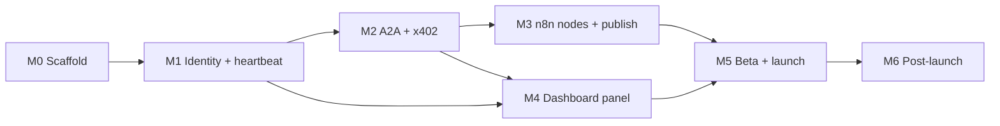

# Zynd n8n Integration — Milestone Phases

A task-level breakdown of the [Rollout Plan](ROLLOUT.md#milestones). Every task links back to the PRD, HLD, LLD and Architecture sections it implements, so you can jump from "what to build this week" to "what it has to look like".

## How to read this

- **Task IDs** (`M2.6`) are stable. Use them in tickets, PR titles and stand-ups.
- **Refs** link to the section that defines the task. The bold text after a link names the exact row, bullet or step inside that section.
- **Done when** is the acceptance check for the task. A milestone is finished when every task is done and its **Exit gate** passes.
- **⚠ G#** marks a task blocked or affected by a gap or contradiction in the docs. See [Open design questions](#open-design-questions).
- **Priority** comes from the PRD: [P0](PRD.md#p0--must-have-for-launch), [P1](PRD.md#p1--should-have), [P2](PRD.md#p2--nice-to-have).

| Doc | What it holds |
| --- | --- |
| [PRD](PRD.md) | Problem, personas, P0/P1/P2 requirements, NFRs, success metrics, assumptions |
| [Architecture](ARCHITECTURE.md) | Why "Thin Node + Gateway", feature lists per component, trust model |
| [HLD](HLD.md) | Components, the five data flows, security layers, infrastructure |
| [LLD](LLD.md) | Files, operations, service methods, dashboard routes, DB schema, error codes |
| [Rollout](ROLLOUT.md) | Milestones, risks, launch checklists |

---

## Phase overview

| Phase | Week | Goal | Exit gate | Main refs |
| --- | --- | --- | --- | --- |
| [M0 — Scaffold](#m0--scaffold-week-1) | 1 | Monorepo with the Gateway and the package, schema, CI and scanner in place; low-footprint stack (Drizzle, bundled build); assumptions checked | Gateway and package build green, scanner runs in CI | [LLD › File Layout](LLD.md#file-layout), [LLD › Module Layout](LLD.md#module-layout), [LLD › Database Schema](LLD.md#database-schema) |
| [M1 — Identity + heartbeat](#m1--identity--heartbeat-week-2) | 2 | Gateway can derive keys, register an agent and keep it alive | Agent registered and heartbeat visible in search | [HLD › Data Flows (3)](HLD.md#data-flows), [LLD › IdentityService](LLD.md#identityservice), [LLD › HeartbeatManager](LLD.md#heartbeatmanager) |
| [M2 — A2A + x402](#m2--a2a--x402-week-3) | 3 | Gateway serves n8n, inbound A2A and outbound paid calls | One paid call completes through Gateway to n8n and back | [HLD › Data Flows (1, 2, 4, 5)](HLD.md#data-flows), [LLD › A2AHandler](LLD.md#a2ahandler), [LLD › PaymentProcessor](LLD.md#paymentprocessor) |
| [M3 — n8n nodes + publish](#m3--n8n-nodes--publish-week-4) | 4 | Verified-ready npm package published | Package on npm, scanner passes, Creator Portal submission filed | [LLD › n8n Package](LLD.md#n8n-package--n8n-nodes-zynd), [Architecture › n8n Node Features](ARCHITECTURE.md#n8n-node-features) |
| [M4 — Dashboard panel](#m4--dashboard-panel-week-5) | 5 | Developers self-serve listings and keys | Developer can create a listing, generate a key and see the agent go live | [LLD › Dashboard — n8n Panel](LLD.md#dashboard--n8n-panel), [Architecture › Dashboard Panel Features](ARCHITECTURE.md#dashboard-panel-features) |
| [M5 — Beta + launch](#m5--beta--launch-week-6) | 6 | Harden, onboard beta builders, launch | All beta builders have at least one live agent on n8n | [Rollout › Before launch](ROLLOUT.md#before-launch-end-of-m5), [PRD › Success Metrics](PRD.md#success-metrics) |
| [M6 — Post-launch](#m6--post-launch-proposed) *(proposed)* | 7+ | P2 features, uptime target | Month-1 uptime ≥ 99.5% | [PRD › P2](PRD.md#p2--nice-to-have) |

## Pending work

Everything still open, by phase. The task rows above hold the detail; this is the index. Update it when a task closes.

### By what unblocks it

| Group | Tasks |
| --- | --- |
| **Needs a decision or action from you** | M0.18 / M0.6 / M1.12 (choose and provision the host, deploy; this unblocks every staging item), M0.9 / M0.10 (push this repo), M0.14 (Ops sign-off), M3.10 (`NPM_TOKEN`, real repository URL and author email in the package, tag `n8n-nodes-zynd@0.1.0`, provenance publish, scanner), M3.11 (Creator Portal submission), M4 deploy (`N8N_GATEWAY_URL` and `SESSION_JWT_SECRET` on the dashboard host, then commit and deploy) |
| **Needs staging (after M1.12)** | M0.11, M0.12, M1.13, M2.3, M2.14\*, M2.17\*, M2.19, M3.12, M4.11, M4.12, M5.3, M5.6 (\* also needs a staging facilitator) |
| **Needs a person to look at it** | M3.1-M3.9 (click through a real n8n), M4.5-M4.10 (open the pages signed in, against a running Gateway), M2.2 (M3 and M4 owners review the contract) |
| **Can be done in this repo now** | Nothing left that needs no host, person or decision; M5.3, M5.6 and M6.2-M6.4 are built and wait for a second host, staging and a look in a browser / real n8n |
| **Later** | G18 (x402 beyond v2 / EVM, mainnet), G19 (SDK servers asking for payment: built, awaiting SDK release), M5 (hardening, beta, launch), M6 (post-launch, proposed) |

### Coding status

Legend: 💻✅ code written and tested locally · 💻⏳ code still to write · 🧑 no code left, a person or an environment has to act.

| Task | Code | What is left |
| --- | --- | --- |
| M0.6, M0.18, M1.12 | 🧑 | Choose and provision the host, deploy |
| M0.20 | 💻✅ | The package is in `packages/n8n-nodes-zynd/` in an npm-workspaces monorepo, with its own CI and publish workflows (rebuilt, see the M0.20 row in M0 section B) |
| M0.9, M0.10, M3.10 | 🧑 | Push this repo, set the real repository URL and author email in the package, `NPM_TOKEN`, tag `n8n-nodes-zynd@0.1.0` |
| M0.11, M0.12, M0.14, M1.13 | 🧑 | Staging AgentDNS and database access, Ops sign-off |
| M2.2 | 🧑 | M3 and M4 owners review the contract |
| M2.3, M2.14, M2.17, M2.19 | 💻✅ | Re-run against staging (M2.14 and M2.17 also need a staging facilitator) |
| M3.1-M3.9 | 💻✅ | Click through a real n8n |
| M3.11, M5.10 | 🧑 | Creator Portal submission and its status |
| M3.12 | 💻✅ | The paid round trip on a self-hosted n8n against staging |
| M4.5-M4.12 | 💻✅ | Look at the pages signed in, walk the listing flow on staging; set `N8N_GATEWAY_URL` and `SESSION_JWT_SECRET` on the dashboard host and deploy |
| M5.1 | 💻✅ | Metrics and alert rules exist; dashboards and alert routing need the host |
| M5.2 | 💻✅ | Nothing |
| M5.3 | 💻✅ | Prove failover on two hosts |
| M5.4 | 💻✅ | Cap logic tested with fakes; the real x402 payment needs a funded wallet and a chain |
| M5.5, M5.8 | 💻✅ | Ops reviews `RUNBOOK.md`; publish `SETUP_GUIDE.md` after the package is on npm |
| M5.6 | 💻✅ | Re-run `npm run measure:latency` against staging with a real facilitator |
| M5.7, M5.11 | 🧑 | Beta builders, announcement |
| **M5.9** | **💻⏳** | **Change the dashboard "Get n8n Nodes" link to the npm install command (small; the package name must be final)** |
| M6.1 | 🧑 | A month of uptime data |
| M6.2, M6.4 | 💻✅ | Look at the analytics chart and Rotate button in a browser; deploy the dashboard |
| M6.3 | 💻✅ | Click the multi-listing trigger through in a real n8n |
| G18 | 💻⏳ | x402 beyond v2 / `exact` / EVM, mainnet and a production facilitator (decision first) |
| G19 | 💻⏳ | Built in both SDKs (`zyndai-ts-sdk` PR #14, `zyndai-python-sdk` PR #15); merge and publish them, then run one paid call against the real facilitator on Base Sepolia |

Everything else in M0-M4 is closed in code. The only code still to write in this repo and the dashboard is M5.9; G18 is a later item; G19 only needs the two SDK PRs merged and published.

### Every open task

| Task | What is left | Blocked on |
| --- | --- | --- |
| M0.6 | Staging host reachable, `/health` returns 200 | M0.18 |
| M0.9 | The package's CI has never run | A push |
| M0.10 | Provenance dry run needs GitHub OIDC | Same push |
| M0.11 | AgentDNS **staging** access (shapes are confirmed locally) | Staging access |
| M0.12 | Decrypt a real staging `developer_keys` row | Staging DB |
| M0.14 | Ops sign-off on Postgres capacity and the standalone host | Ops |
| M0.18 | Choose and provision the standalone Gateway host | Ops decision |
| M1.12 | Deploy the Gateway to staging, `/health` returns 200 | M0.18 |
| M1.13 | Run the e2e test against staging with the default 300 s threshold | M1.12 |
| M2.2 | Review of the `/n8n/v1/*` contract by the M3 and M4 owners | M3 / M4 owners |
| M2.3 | Re-measure search overhead (p99 < 50 ms) against staging | M1.12 |
| M2.14 | A paid outbound call to a real staging agent | M1.12, staging facilitator |
| M2.17 | E2E on staging: external agent pays, n8n completes | M1.12, staging facilitator |
| M2.19 | Run an SDK client against a deployed Gateway | M1.12 |
| G18 | x402 beyond v2 / `exact` / EVM; mainnet and a production facilitator | M5 |
| G19 | SDK PRs (#14 TS, #15 Python) merged and published; one paid call against the real facilitator | Upstream SDK release |
| M3.1-M3.9 | Click-through in a real n8n (Test credential, AI Agent tool use, error messages in the UI) | A running n8n |
| M3.10 | Push this repo, fix the repository URL and author email in the package, add `NPM_TOKEN`, tag `n8n-nodes-zynd@0.1.0`; check the provenance badge and scanner | You |
| M3.11 | File the Creator Portal submission and record its ID | M3.10 |
| M3.12 | The paid round trip on a self-hosted n8n against staging | M1.12, M3.10 |
| M4.5-M4.10 | Look at the pages in a browser, signed in, against a running Gateway; fix what shows | A dashboard login and a running Gateway |
| M4.11-M4.12 | Walk the listing flow on staging; tick the before-beta checklist | M1.12 |
| M4.* | Set `N8N_GATEWAY_URL` and `SESSION_JWT_SECRET` (same value as the Gateway) on the dashboard host; commit and deploy the dashboard changes | You |
| M5.1 | Dashboards and alert routing on the host (metrics endpoint and rules exist) | M0.18 |
| M5.3 | Prove failover with two hosts: kill one, agents stay active (built and tested locally) | Two hosts (M0.18) |
| M5.4, M5.7, M5.9-M5.11 | Spend cap test with real x402, beta, link update, Creator Portal, announce | M3, M4, staging |
| M5.6 | Re-run the latency measure against staging with a real facilitator (local run: p50 about 425 ms) | M1.12, staging facilitator |
| M6.2-M6.4 | Look at the analytics chart and Rotate button in a browser; click the multi-listing trigger through in a real n8n; deploy the dashboard changes | A dashboard login, a running n8n |
| M5.5, M5.8 | Review of `RUNBOOK.md`; publish `SETUP_GUIDE.md` | You |

M2 is closed in this repo (M2.18, M2.20 and M2.21 are done). M3 and M4 are built; what remains is listed above.

### Dependencies between phases

M3 and M4 both need the Gateway API from M2, but not each other. Once the `/n8n/v1/*` contracts are frozen early in M2, node work (M3) and panel work (M4) can start in parallel. That gives slack against the [verification review risk](ROLLOUT.md#risk-mitigation).

---

## M0 — Scaffold (Week 1)

**Goal:** Stand up the monorepo (Gateway at the root, `n8n-nodes-zynd` in `packages/n8n-nodes-zynd/`) with the constraints that are expensive to retrofit: zero runtime deps, scanner in CI, and the shared schema.
**Exit gate:** Gateway and package build green ([Rollout › Milestones](ROLLOUT.md#milestones), row M0), and the scanner runs in CI from day 1 ([Rollout › Risk Mitigation](ROLLOUT.md#risk-mitigation), **n8n scanner rejects package**).

### A. Gateway repo — `zynd-n8n-gateway`

| ID | Task | Done when | Refs |
| --- | --- | --- | --- |
| M0.1 | Create Express app with `src/routes`, `src/middleware`, `src/services`, `src/db`. Add deps `@noble/curves`, `@noble/hashes`, `ws`, `drizzle-orm`, `postgres`, `express` ✅ **Done.** Express app with `src/routes`, `src/middleware`, `src/services`, `src/db`; the listed dependencies are in `package.json`. | App boots locally and the folder layout matches the LLD | [LLD › Module Layout](LLD.md#module-layout), [HLD › Components](HLD.md#components) (**Zynd n8n Gateway**), [PRD › Project Overview](PRD.md#project-overview) (**New repos**) |
| M0.2 | Add a `/health` endpoint ✅ **Done.** `GET /health` (`src/routes/health.ts`). | Returns 200 | [Rollout › Before beta](ROLLOUT.md#before-beta-end-of-m4) (**health endpoint**), [Rollout › Risk Mitigation](ROLLOUT.md#risk-mitigation) (**Gateway single point of failure**) |
| M0.3 | Add an error middleware and code catalogue that return `{ error, code, details? }` ✅ **Done.** `src/errors.ts` holds the catalogue and `middleware/errorHandler.ts` renders `{ error, code, details? }`. | Each code in the LLD table maps to its HTTP status | [LLD › Error Handling](LLD.md#error-handling) |
| M0.4 | Add Drizzle tables `n8n_api_key`, `n8n_listing`, `n8n_task`, `n8n_heartbeat` (plus the counter and nonce tables) and their enums. Map `Developer` and `DeveloperKey` read-only ✅ **Done.** `src/db/schema.ts` and migrations 0000-0002; applying twice on a fresh Postgres is a no-op (CI runs it). Dashboard tables are mirrored read-only. G4, G5, G12, G13 decided. | Migration applies cleanly to a copy of the shared Postgres. ⚠ G4, G5, G12, G13 | [LLD › Database Schema](LLD.md#database-schema), [LLD › N8nApiKey](LLD.md#n8napikey), [LLD › N8nListing](LLD.md#n8nlisting), [LLD › N8nTask](LLD.md#n8ntask), [LLD › N8nHeartbeat](LLD.md#n8nheartbeat), [PRD › Project Overview](PRD.md#project-overview) (**Shared infra: 4 new tables**) |
| M0.5 | Set up CI for lint, typecheck, test and build ✅ **Done.** `.github/workflows/ci.yml`: drizzle check, lint, typecheck, migrations (twice), tests against Postgres, build, memory guard. | PR checks pass on `main` | [Rollout › Milestones](ROLLOUT.md#milestones) (row M0) |
| M0.6 | Provision a small standalone staging host (about 256 MB RAM; not zynd-deployer) ⏳ **Open.** Same blocker as M0.18 (no host chosen). | Staging URL reachable, `/health` returns 200 | [HLD › Infrastructure](HLD.md#infrastructure) (**Gateway**), [PRD › Project Overview](PRD.md#project-overview) (**No new infra**, **Why a new service**) |

### B. n8n package — `n8n-nodes-zynd` (in `packages/n8n-nodes-zynd/` of this repo)

**Decision:** the package lives in this repository as a monorepo (npm workspaces) instead of getting its own, in `packages/n8n-nodes-zynd/` (done in M0.20). The code in `packages/n8n-nodes-zynd/` is the only copy: the earlier build in `../n8n-nodes-zynd` was not on disk when M0.20 was done, so the package was rebuilt (see M0.20).

| ID | Task | Done when | Refs |
| --- | --- | --- | --- |
| M0.7 | Write `package.json`: `n8n-community-node-package` keyword, peer dep on `n8n-workflow`, **zero** `dependencies`, MIT licence, English metadata ✅ **Done.** Keyword, `n8n-workflow` peer dependency, MIT, zero `dependencies`; `npm pack` shows 10 files, 32.7 kB unpacked (`npm run size` enforces the budget). | `npm pack` shows no runtime deps | [LLD › File Layout](LLD.md#file-layout), [PRD › Non-Functional Requirements](PRD.md#non-functional-requirements) (**Compliance**, **Package size**), [Architecture › Why this architecture](ARCHITECTURE.md#why-this-architecture) (**Zero runtime deps**) |
| M0.8 | Create a `tsc`-only build and empty shells: `ZyndApi.credentials.ts`, `Zynd.node.ts`, `ZyndTrigger.node.ts`, `zynd.svg` ✅ **Done.** `npm run build` (`n8n-node build`: `tsc` plus a copy of the icons, no bundler) emits `dist/` with the credential, `Zynd` and `ZyndTrigger` and their two icons (`zynd.svg`, `zynd.dark.svg`). | `npm run build` emits `dist/` | [LLD › File Layout](LLD.md#file-layout) |
| M0.20 | Move the package into `packages/n8n-nodes-zynd/` and set up the npm-workspaces monorepo, CI and publish workflows ✅ **Done.** npm-workspaces monorepo: root `workspaces: ["packages/*"]` and one lock-file; the root `eslint` and `vitest` configs skip `packages/**` and the root `tsc` only includes `src` and `test`; the package keeps its own build, lint, typecheck and tests (`npm run build:nodes`, `lint:nodes`, `test:nodes` at the root); `repository.directory` is set; `test/n8nNodes.e2e.test.ts` loads `packages/n8n-nodes-zynd/dist`; `ci.yml` builds the package before the tests so the e2e runs. **The package was written again, not moved:** `../n8n-nodes-zynd` was not on disk (only the old v0.1.0 `../n8n-nodes-zyndai`: five nodes, heavy dependencies), so the credential, `Zynd` and `ZyndTrigger` were rebuilt from the LLD and the e2e test on `n8n-workflow` 2.47 and `@n8n/node-cli` 0.56, with the old package as reference only. Checked from a clean copy with one `npm ci`: package lint 0 errors (2 warnings, the optional JSON fields), 64 package tests, 7 e2e tests against the compiled package, Gateway bundle unchanged (1,192,231 B), memory guard ok. `npm pack` is therefore not "unchanged" but new: 10 files, 32.7 kB unpacked, zero dependencies | Both build and test from a fresh checkout with one `npm ci`; `npm pack` in the package is unchanged; the Gateway bundle does not grow | [LLD › Repository layout](LLD.md#repository-layout-monorepo), [PRD › Project Overview](PRD.md#project-overview) |
| M0.9 | Add `.github/workflows/ci.yml` with lint, build and `npx @n8n/scan-community-package`. Add lint rules that ban `console`, `process`, `crypto` and `fs` 🟡 **Done locally, CI not yet run.** `/.github/workflows/n8n-nodes-ci.yml` (only for `packages/n8n-nodes-zynd/**`) runs lint, typecheck, tests, build and `npm run size`. Lint is `n8n-node lint` with the unmodified default config (strict mode requires that); its `@n8n/eslint-plugin-community-nodes` rules ban `console`, `process`, `crypto`, `fs`, other Node modules and any import but `n8n-workflow`, and `test/package.test.ts` repeats the bans on the shipped source. `@n8n/scan-community-package` only accepts published packages, so it runs in `n8n-nodes-publish.yml` after the real publish (M3.10). ⏳ **Open:** the workflows have never run on GitHub; they run for the first time when this repo is pushed | CI is green, and the scanner reports zero issues on the shells | [Rollout › Risk Mitigation](ROLLOUT.md#risk-mitigation) (**scanner from day 1**), [Architecture › Why this architecture](ARCHITECTURE.md#why-this-architecture) (**No crypto**, **No process/console**, **No env vars / file access**), [PRD › Problem](PRD.md#problem) (the five rules v0.1.0 broke) |
| M0.10 | Add a `.github/workflows/publish.yml` skeleton that runs `npm publish --provenance` on version tags (dry-run only) 🟡 **Skeleton done, dry run not yet seen.** `/.github/workflows/n8n-nodes-publish.yml` runs `npm publish --provenance` in `packages/n8n-nodes-zynd` on a tag `n8n-nodes-zynd@<version>` (it checks the tag against `package.json`, then runs the scanner on the published version); a manual run is a dry run unless unticked. ⏳ **Open:** provenance needs GitHub OIDC, so it can only be confirmed once the repo is pushed. To check on the first dry run: that npm provenance and the scanner accept a package published from a subdirectory (`repository.directory`); this is assumed, not verified. **Set before the first publish:** `repository.url`, `homepage` and the credential's `documentationUrl` assume `github.com/zyndai/zynd-n8n-gateway`, and `author.email` is a placeholder (`maintainers@example.invalid`, the n8n linter insists on one); fix all of these to the real values | Dry run succeeds with the provenance flag | [LLD › File Layout](LLD.md#file-layout), [PRD › P0](PRD.md#p0--must-have-for-launch) (**npm publish with provenance**) |

### C. Check assumptions

| ID | Task | Done when | Refs |
| --- | --- | --- | --- |
|  M0.11 | Confirm AgentDNS staging access and the shape of `/v1/search`, `/v1/entities` and `/v1/entities/{id}/ws` 🟡 Shapes confirmed from the AgentDNS source and a local node: `POST /v1/entities`, `GET /v1/entities/{id}`, `GET /v1/entities/{id}/ws`, `POST /v1/search`. Staging access is still open. | Smoke calls succeed from the Gateway staging host | [PRD › Dependencies and Assumptions](PRD.md#dependencies-and-assumptions) (**AgentDNS API is stable**), [HLD › Data Flows](HLD.md#data-flows)  |
|  M0.12 | Confirm the Gateway can run the dashboard's `decryptPrivateKey` path (same AES-256-GCM key material) 🟡 **Partly done in M1.** The dashboard stores `developer_keys.private_key_enc` as `base64(iv‖tag‖ciphertext)` under `PKI_ENCRYPTION_KEY`; the Gateway decrypts exactly that (tested against an independent re-implementation of the dashboard's `decryptPrivateKey`). Still open: decrypt a real staging row. **Correction:** the dashboard has no `Developer`/`DeveloperKey` tables; the table is `developer_keys` and a developer is identified by `developer_id` (`zns:dev:…`). The M0 mirror and migration were wrong and are fixed. | A test decrypts a staging `DeveloperKey` | [PRD › Dependencies and Assumptions](PRD.md#dependencies-and-assumptions) (**same decryption path**), [LLD › IdentityService](LLD.md#identityservice)  |
|  M0.13 | Confirm the TS SDK's Ed25519 functions can be used without importing the full SDK ✅ **Decided in M1: depend on `@noble/curves` and `@noble/hashes` directly, do not import the SDK.** The ~60 lines of derivation, proof and signing live in `IdentityService`; they are tested against vectors produced by the SDK and against Go's `derive-agent` output. | Decide whether to vendor or depend on the SDK, and record the decision | [PRD › Dependencies and Assumptions](PRD.md#dependencies-and-assumptions) (**TS SDK's Ed25519 functions**)  |
| M0.14 | Confirm Postgres capacity and the standalone host | Ops sign-off | [PRD › Dependencies and Assumptions](PRD.md#dependencies-and-assumptions) (**Postgres capacity**, **small always-on host**) |
| M0.15 | Resolve the schema-affecting [open questions](#open-design-questions) (G1, G3, G4, G5, G12, G13) before the first migration ✅ **Done.** G1, G3, G4, G5, G12 and G13 are decided above and recorded in the LLD (webhook secret encrypted, outbound identity, timestamps, `n8n_nonce`, migration ownership, `n8n_derivation_counter`). | Decisions recorded in the LLD | [Open design questions](#open-design-questions) |

### D. Low-footprint stack (added)

The Gateway only holds keys and keeps heartbeats alive, so it runs as one small process on its own host and is **not** deployed on zynd-deployer (full agent hosting, one Docker container per agent). Budget: idle RSS ≤ 80 MB, peak ≤ 100 MB under load, heap capped at 96 MB. See [HLD › Infrastructure](HLD.md#infrastructure).

| ID | Task | Done when | Refs |
| --- | --- | --- | --- |
| M0.16 | ✅ **Done.** Replace Prisma with Drizzle (`drizzle-orm`, `postgres`, `drizzle-kit`). Gateway tables in `src/db/schema.ts`; dashboard tables mirrored in `src/db/dashboard.ts` and kept out of migrations (`tablesFilter: ['n8n_*']`); history kept in the separate `drizzle` schema | `drizzle-kit migrate` creates only the six `n8n_*` tables next to existing `Developer`/`DeveloperKey` tables, re-running is a no-op, and the DB integration tests pass. ⚠ G12 | [LLD › Module Layout](LLD.md#module-layout), [LLD › Database Schema](LLD.md#database-schema), [LLD › Migration ownership](LLD.md#migration-ownership-g12) |
| M0.17 | ✅ **Done.** Bundle the Gateway with esbuild into one minified file (`dist/index.mjs`); `tsc` is for type checks only. `npm start` caps the heap at 96 MB; DB pool defaults to 4 connections | Measured idle RSS 74 MB (unbundled: 185 MB) and 97 MB after 6,000 requests at 40 concurrent | [PRD › Non-Functional Requirements](PRD.md#non-functional-requirements), [HLD › Infrastructure](HLD.md#infrastructure) |
| M0.18 | Choose the standalone host for the Gateway (about 256 MB RAM, always on, outbound WebSockets, Postgres reachable). Replaces the zynd-deployer slot in M0.6 | Host named, staging URL reachable, `/health` returns 200 | [HLD › Infrastructure](HLD.md#infrastructure), [PRD › Project Overview](PRD.md#project-overview) (**Separate, minimal host**) |
| M0.19 | Add a memory guard to CI: start the built bundle, hit `/health` repeatedly, fail if RSS exceeds the budget ✅ **Done.** `npm run check:memory` (`scripts/check-memory.mjs`) boots the bundle exactly as `npm start`, sends 3,000 `/health` requests at 20 concurrency and fails if RSS passes the budget; CI runs it with Postgres. Bare idle 81.8 MB / peak 95.7 MB (budget 85 / 100); with the database 83.7 / 97.3 MB (budget 95 / 110, the PRD figures). The original 80 MB bare budget was missed once M2 landed; M2.18 found no single cause (the growth is spread over the new code) and kept 85 / 100. | CI fails when a new dependency pushes idle RSS past its budget (85 MB bare, 95 MB with the database) | [PRD › Non-Functional Requirements](PRD.md#non-functional-requirements) |

---

## M1 — Identity + heartbeat (Week 2)

**Goal:** The Gateway can turn a developer key into a live, discoverable AgentDNS agent and keep it alive. This implements [HLD › Data Flows](HLD.md#data-flows) **flow 3 (Listing activation)**.
**Exit gate:** Agent registered and heartbeat visible in search ([Rollout › Milestones](ROLLOUT.md#milestones), row M1).

### A. IdentityService

| ID | Task | Done when | Refs |
| --- | --- | --- | --- |
| M1.1 | ✅ **Done.** Load `DeveloperKey`, decrypt with AES-256-GCM, then `deriveKeypair(devKeyBytes, index)` (HD derivation) Tested against the TS SDK and Go `derive-agent` (same entity ids for indexes 0 and 7). The developer key is read from the dashboard's `developer_keys` table (see the schema fix below), decrypted, and zeroed after use. | Same index gives the same keypair every time; different indexes give different keypairs | [LLD › IdentityService](LLD.md#identityservice) (**deriveKeypair**), [Architecture › Gateway Features](ARCHITECTURE.md#gateway-features) (**Identity Derivation**), [HLD › Security Model](HLD.md#security-model) (**Key storage**), [PRD › NFRs](PRD.md#non-functional-requirements) (**Security**)  |
| M1.2 | ✅ **Done.** Allocate `derivedKeyIndex` per listing so it is unique per developer and never reused Allocated in one transaction from `n8n_derivation_counter` (`ListingStore.createListing`). Tested with 25 concurrent creates against Postgres. | DB constraint plus a concurrent-create test. ⚠ G13 | [LLD › N8nListing](LLD.md#n8nlisting) (**derivedKeyIndex**)  |
| M1.3 | ✅ **Done.** Cache derived keypairs in memory per listing, and invalidate on rotation or deactivation Per-listing keypair cache in `IdentityService`; concurrent first calls share one decryption, failures are not cached, and the developer master key itself is never cached. Deactivation calls `invalidate`; `invalidateDeveloper` is ready for M6.4. | The second call does no decryption | [Rollout › Risk Mitigation](ROLLOUT.md#risk-mitigation) (**Key decryption adds latency**)  |
| M1.4 | ✅ **Done.** Implement `signRegistration` (canonical JSON + signature) and `createDerivationProof` Registration signable and derivation proof match the SDK byte for byte. The real AgentDNS node accepted both. | AgentDNS staging accepts the signature and the proof | [LLD › IdentityService](LLD.md#identityservice) (**signRegistration**, **createDerivationProof**), [HLD › Security Model](HLD.md#security-model) (**Gateway to AgentDNS**)  |
| M1.5 | ✅ **Done.** Implement `signHeartbeat` (RFC 3339 timestamp + signature) RFC 3339 at second precision; the real node accepted the frames and kept the agent active past its inactivity threshold. | AgentDNS accepts a heartbeat frame | [LLD › IdentityService](LLD.md#identityservice) (**signHeartbeat**)  |

### B. Registration

| ID | Task | Done when | Refs |
| --- | --- | --- | --- |
| M1.6 | ✅ **Done.** Implement the listing state machine DRAFT → REGISTERING → ACTIVE / INACTIVE / ERROR `listingState.ts` plus compare-and-set updates in `ListingStore.transition`. All 25 (from, to) pairs are unit-tested; the CAS is tested against Postgres. A `REGISTERING` listing older than 2 minutes is treated as abandoned and can be re-claimed. | Each transition is covered by a unit test | [LLD › N8nListing](LLD.md#n8nlisting) (**status**)  |
| M1.7 | ✅ **Done.** Implement the registration flow: sign, `POST /v1/entities`, set `entity_url = https://gw.zynd.ai/a/{entityId}`, store `entityId` `ListingService.activate`. The `entityId` is a pure function of the public key, so `entity_url` is known before registration. A 409 from AgentDNS counts as success when the registry already holds our key (crash between register and DB write). ⚠ G7 decided below. | Entity exists on AgentDNS staging. ⚠ G7 | [HLD › Data Flows](HLD.md#data-flows) (**3. Listing activation**), [Architecture › Dashboard Panel Features](ARCHITECTURE.md#dashboard-panel-features) (**One-Click Activation**)  |
| M1.8 | ✅ **Done.** Add an internal registration endpoint in `src/routes/dashboard.ts` behind `sessionAuth.ts` (Session JWT) `POST /internal/v1/listings/:id/activate` (plus create, list, get, deactivate). Session JWT format decided in G9 below. | A dashboard JWT can trigger registration. ⚠ G9 | [LLD › Module Layout](LLD.md#module-layout), [HLD › Architecture](HLD.md#architecture) (**Session JWT** edge)  |

### C. HeartbeatManager

| ID | Task | Done when | Refs |
| --- | --- | --- | --- |
| M1.9 | ✅ **Done.** Implement `start(entityId, keypair)` and `stop(entityId)` over a `Map<entityId, WebSocket>`. Send a signed beat every 30 s to `/v1/entities/{id}/ws` `HeartbeatManager` with injectable sockets. Beyond the LLD: `perMessageDeflate` is off (saves a zlib context per socket), each beat carries a ping, and a missing pong counts as a failure (catches half-open TCP). | Beats arrive every 30 s and `N8nHeartbeat.lastBeatAt` updates. ⚠ G8 | [LLD › HeartbeatManager](LLD.md#heartbeatmanager) (**start**, **stop**), [LLD › N8nHeartbeat](LLD.md#n8nheartbeat), [PRD › P0](PRD.md#p0--must-have-for-launch) (**Heartbeat**), [Architecture › Gateway Features](ARCHITECTURE.md#gateway-features) (**Heartbeat Management**)  |
| M1.10 | ✅ **Done.** Reconnect with exponential backoff 1 → 2 → 4 → … 30 s, and set FAILED after 5 consecutive failures. Track `failCount` Delays 1, 2, 4, 8 s, FAILED on the 5th failure, then retries continue at 16 s and the 30 s cap rather than stopping for good, so a registry outage longer than ~15 s does not strand every agent until a restart. The failure counter resets only after a connection survives a second beat, so a server that accepts then drops is backed off instead of hit every second. | A fault-injection test (kill the socket) shows the backoff sequence and FAILED on the 5th failure | [LLD › HeartbeatManager](LLD.md#heartbeatmanager) (**Reconnect**), [PRD › NFRs](PRD.md#non-functional-requirements) (**Heartbeat reliability**), [Rollout › Risk Mitigation](ROLLOUT.md#risk-mitigation) (**Heartbeat WebSocket drops**)  |
| M1.11 | ✅ **Done.** On boot, query ACTIVE listings and resume their heartbeats `HeartbeatManager.resumeActive()` runs from `index.ts` on boot. One bad listing never blocks the rest. Measured: 200 listings recovered in 0.5 s. | After a Gateway restart, all agents stay searchable | [LLD › HeartbeatManager](LLD.md#heartbeatmanager) (**Startup recovery**), [Architecture › Gateway Features](ARCHITECTURE.md#gateway-features) (**Auto-Recovery**)  |

### D. Verify

| ID | Task | Done when | Refs |
| --- | --- | --- | --- |
|  M1.12 | Deploy the Gateway to staging ⏳ **Open.** Needs the standalone host from M0.18 (`npm start` boots and answers `/health` locally). | `/health` returns 200 on staging | [Rollout › Before beta](ROLLOUT.md#before-beta-end-of-m4), [HLD › Infrastructure](HLD.md#infrastructure)  |
|  M1.13 | Integration test against AgentDNS staging: register → heartbeat → appears in search → stop → marked inactive after 300 s ✅ **Scripted and passing against a real local AgentDNS node** (`test/agentdns.e2e.test.ts`, opt-in; header lists the env). It registers, proves the agent *stays* active past the node's inactivity threshold while beating (a fresh entity is already `active`, so a status check alone proves nothing), then stops and watches it flip to inactive. ⏳ Still to run against staging, with the default 300 s threshold. | Exit gate passes in CI or as a scripted run | [Rollout › Milestones](ROLLOUT.md#milestones) (row M1), [PRD › P0](PRD.md#p0--must-have-for-launch) (**Heartbeat**: inactive after 300 s), [HLD › Data Flows](HLD.md#data-flows) (**5. Trigger lifecycle**)  |
|  M1.14 | ✅ **Done.** Measure Gateway memory with a live Postgres pool and 200 simulated heartbeat sockets (the bundle was only measured on `/health`) `npm run measure:memory` boots the bundled Gateway against 200 recovered listings and 200 live sockets and loads the dashboard API (6,000 requests at 40 concurrency, 200 × 97 KB list responses). Result: idle **78–88 MB**, peak **94–101 MB** (runs vary ±5 MB). The budget is revised in the PRD (see Memory footprint). `ws` costs about 63 KB per socket (12 MB for 200); `--max-semi-space-size=2 --optimize-for-size` cut the load peak from ~160 MB to ~100 MB with unchanged throughput. | Idle RSS ≤ 80 MB and peak ≤ 100 MB, or the budget is revised in the PRD with the measured numbers | [PRD › Non-Functional Requirements](PRD.md#non-functional-requirements), [LLD › HeartbeatManager](LLD.md#heartbeatmanager), M0.17  |

---

## M2 — A2A + x402 (Week 3)

**Goal:** The Gateway serves all three audiences: the n8n node (API key), other agents (A2A + x402), and outbound calls on behalf of builders. This implements [HLD › Data Flows](HLD.md#data-flows) **flows 1, 2, 4 and 5**.
**Exit gate:** One paid call completes through the Gateway to n8n and back ([Rollout › Milestones](ROLLOUT.md#milestones), row M2). The n8n nodes don't exist until M3, so use a plain n8n Webhook node or an HTTP stub as the receiver.

### A. n8n-facing API (`src/routes/n8n.ts`)

| ID | Task | Done when | Refs |
| --- | --- | --- | --- |
| M2.1 | Write `apiKeyAuth.ts`: hash `X-Zynd-Api-Key` with SHA-256, look it up, reject revoked or expired keys, check `permissions`, update `lastUsedAt` ✅ **Done.** `middleware/apiKeyAuth.ts`. The key is hashed with SHA-256 (lower-case hex) and looked up; revoked and unknown keys give the same `AUTH_INVALID`. `lastUsedAt` is written best-effort. Permission per route: `search` → agents search; `call` → call agent and get task; `complete` → jobs, listings and webhooks. | Returns `AUTH_INVALID` / `AUTH_EXPIRED` / `AUTH_FORBIDDEN` with the right statuses | [HLD › Security Model](HLD.md#security-model) (**n8n to Gateway**), [LLD › N8nApiKey](LLD.md#n8napikey), [LLD › Error Handling](LLD.md#error-handling), [PRD › P0](PRD.md#p0--must-have-for-launch) (**API key auth**) |
| M2.2 | Freeze the `/n8n/v1/*` contract (OpenAPI or typed client) so M3 and M4 can run in parallel 🟡 **Implemented, review open.** Typed contract in `src/n8nContract.ts` (the routes return exactly these shapes) and the prose version in [N8N_API.md](N8N_API.md). ⏳ **Open:** the M3 and M4 owners have not reviewed it, and "Done when" requires that. | Contract reviewed and committed | [LLD › Zynd Node — Action](LLD.md#zynd-node--action), [LLD › ZyndTrigger Node](LLD.md#zyndtrigger-node) |
| M2.3 | `GET /n8n/v1/agents` proxies to AgentDNS `POST /v1/search` (`q`, `category`, `limit`, `offset`) 🟡 **Implemented, staging check open.** `limit` 1-100 (default 20), `offset` 0-10000; the AgentDNS body is passed through. Test measures p99 overhead against calling the fake registry directly (< 50 ms); ⏳ **Open:** the p99 < 50 ms check has only run against the fake registry; re-measure against staging. | Results match AgentDNS. Gateway overhead under 50 ms p99 | [HLD › Data Flows](HLD.md#data-flows) (**1. Agent search**), [PRD › P0](PRD.md#p0--must-have-for-launch) (**Search agents**), [PRD › NFRs](PRD.md#non-functional-requirements) (**Latency**) |
| M2.4 | `GET /n8n/v1/listings` returns the listings tied to the key's developer ✅ **Done.** | Lists only that developer's listings | [LLD › Zynd Node — Action](LLD.md#zynd-node--action) (**List listings**), [Architecture › n8n Node Features](ARCHITECTURE.md#n8n-node-features) (**List Listings**) |
| M2.5 | `GET` / `POST` / `DELETE /n8n/v1/webhooks`: bind `{ url, secret, listingId }` to a listing, start the heartbeat on create, stop it on delete ✅ **Done.** G14 decided: the webhook id is the listing id. `POST` stores the secret encrypted (G1), registers a DRAFT/ERROR listing, and starts the heartbeat; an INACTIVE listing is left inactive. `DELETE` clears the URL and stops the heartbeat (when `HEARTBEAT_REQUIRES_WEBHOOK`). URLs are checked (`webhookUrl.ts`): http(s) only, no credentials, and outside production loopback/private hosts are refused. | Create makes the agent live and delete stops beats. ⚠ G1, G7, G14 | [LLD › ZyndTrigger Node](LLD.md#zyndtrigger-node), [HLD › Data Flows](HLD.md#data-flows) (**5. Trigger lifecycle**), [LLD › N8nListing](LLD.md#n8nlisting) (**webhookUrl**, **webhookSecretHash**) |

### B. Inbound paid calls (`src/routes/a2a.ts`)

| ID | Task | Done when | Refs |
| --- | --- | --- | --- |
| M2.6 | Write `a2aAuth.ts`: verify `x-zynd-auth` (JCS canonicalisation, domain tag, nonce replay protection) ✅ **Done.** `zyndAuth.ts` + `middleware/a2aAuth.ts`. The block is in `params.message.metadata["x-zynd-auth"]`, not an HTTP header (as in the TS SDK; a fixture signed by the SDK verifies). The nonce is claimed only after the signature verifies. G5 table is used. The caller is verified against the public key it presents (and the entity id hash), not against the listing's key (the LLD wording was wrong). | A replayed nonce is rejected and a bad signature is rejected. ⚠ G5 | [HLD › Security Model](HLD.md#security-model) (**Gateway to agents**), [LLD › Module Layout](LLD.md#module-layout) |
| M2.7 | `PaymentProcessor.verifyX402(headers, body)` ✅ **Done.** x402 v2, `exact` scheme on EVM: structure, amount, recipient, validity window, EIP-712 signature recovery, in-process nonce replay, then the facilitator's `/verify`. Signature is `verifyX402(headers, requirements)` (the LLD's `body` argument cannot define what was owed). See G17. | A valid proof passes and an invalid one returns `PAYMENT_FAILED` (402) | [LLD › PaymentProcessor](LLD.md#paymentprocessor), [HLD › Security Model](HLD.md#security-model) (**x402 payments**), [Architecture › Gateway Features](ARCHITECTURE.md#gateway-features) (**x402 Payments**) |
| M2.8 | `WebhookForwarder.forward`: POST with `X-Zynd-Webhook-Secret`, retry once on 5xx after 2 s, 10 s connect / 30 s response timeouts ✅ **Done.** `node:http(s)` instead of fetch, so connect (10 s) and response (30 s) time out separately. Retry once after 2 s on 5xx or a failed connection; a response timeout and a 4xx are not retried. Redirects are not followed. | Unit tests cover the retry and timeout paths. ⚠ G1 | [LLD › WebhookForwarder](LLD.md#webhookforwarder), [HLD › Security Model](HLD.md#security-model) (**Gateway to n8n**), [Architecture › Gateway Features](ARCHITECTURE.md#gateway-features) (**Webhook Forwarding**) |
| M2.9 | A2AHandler `tasks/send`, all 7 steps: listing ACTIVE → verify auth → verify x402 → create INBOUND PENDING task → forward → poll every 2 s (300 s cap) → JSON-RPC response ✅ **Done.** Tested end to end over real HTTP. The payment is verified up front and settled only after the job COMPLETED (G17). A webhook response carrying `output` finishes the job at once; otherwise a waiting call is woken the moment `jobs/complete` lands (G2). | End-to-end inbound test passes. ⚠ G2 | [LLD › A2AHandler](LLD.md#a2ahandler) (steps 1–7), [HLD › Data Flows](HLD.md#data-flows) (**4. Inbound paid call**), [PRD › P0](PRD.md#p0--must-have-for-launch) (**Receive paid calls**) |
| M2.10 | A2AHandler `tasks/get` and `tasks/cancel` ✅ **Done.** G6 decided below. `message/send` is accepted as an alias of `tasks/send` because that is what the SDK client calls. | JSON-RPC conformance tests pass. ⚠ G6 | [Architecture › Gateway Features](ARCHITECTURE.md#gateway-features) (**A2A Protocol**) |
| M2.11 | `POST /n8n/v1/jobs/:id/complete` stores `output` and sets COMPLETED, or FAILED with `error` ✅ **Done.** Compare-and-set, so a late completion of a TIMEOUT or CANCELED task is refused (409), and one developer cannot complete another's job (404). | A waiting `tasks/send` returns the output | [HLD › Data Flows](HLD.md#data-flows) (**4. Inbound paid call**), [LLD › Zynd Node — Action](LLD.md#zynd-node--action) (**Complete job**), [Architecture › n8n Node Features](ARCHITECTURE.md#n8n-node-features) (**Complete Job**), [Architecture › Gateway Features](ARCHITECTURE.md#gateway-features) (**Task Store**) |
| M2.12 | Task timeout: after 300 s set TIMEOUT and return `TASK_TIMEOUT` (504). Reject inactive listings with `LISTING_INACTIVE` (409) ✅ **Done.** A listing with no webhook bound also answers `LISTING_INACTIVE`. | Tests cover both errors | [LLD › A2AHandler](LLD.md#a2ahandler) (step 6), [LLD › N8nTask](LLD.md#n8ntask) (**status**), [LLD › Error Handling](LLD.md#error-handling) |

### C. Outbound paid calls

| ID | Task | Done when | Refs |
| --- | --- | --- | --- |
| M2.13 | `PaymentProcessor.deriveEvmKey` (SHA-256 of the Ed25519 key → secp256k1 → EVM account) and `signX402(devKey, amount, recipient)` ✅ **Done.** On `@noble` only (no viem). Address, EIP-712 signature and signer recovery are byte-identical to viem's for the same seed (`test/fixtures/x402-vectors.json`). `signX402(devKey, requirements)` takes the target's payment requirements, because network, asset and token domain are needed to sign. | The derived address matches the reference SDK, and a signed header verifies | [LLD › PaymentProcessor](LLD.md#paymentprocessor), [HLD › Security Model](HLD.md#security-model) (**x402 payments**) |
| M2.14 | `POST /n8n/v1/agents/:id/tasks`: derive the caller identity, sign the A2A request, attach x402 within `maxPaymentUsd`, POST to `entity_url`, poll, return. Store an OUTBOUND `N8nTask` 🟡 **Implemented, staging run open.** Passes against a fake remote agent that runs the same verifiers. ⏳ **Open:** "Done when" needs a call to a real staging agent. G3 as decided in M0: signed with the developer master key. After the 402 the message is re-signed with a fresh nonce. | A call to a staging agent returns its result. ⚠ G3 | [HLD › Data Flows](HLD.md#data-flows) (**2. Outbound call**), [LLD › Zynd Node — Action](LLD.md#zynd-node--action) (**Call agent**), [PRD › P0](PRD.md#p0--must-have-for-launch) (**Call agent**) |
| M2.15 | `GET /n8n/v1/tasks/:id` ✅ **Done.** Scoped to the API key that made the call (stricter than "developer"). | Returns status and output for the key's own tasks only | [LLD › Zynd Node — Action](LLD.md#zynd-node--action) (**Get task**) |
| M2.16 | **[P1] Spend enforcement**: increment `spentUsd` atomically before signing, reject with `PAYMENT_CAP` (402) if the call would exceed `spendCapUsd`. It sits in the payment path, so build it here ✅ **Done.** One conditional `UPDATE`; tested with 40 concurrent reservations against Postgres (exactly 20 of 0.05 fit under a 1.00 cap). A reservation is refunded only when the agent refused the paid request and reported no settlement; otherwise it is kept, so spend is never undercounted. | A concurrent-call test never overshoots the cap | [PRD › P1](PRD.md#p1--should-have) (**Spend caps**), [Architecture › Gateway Features](ARCHITECTURE.md#gateway-features) (**Spend Enforcement**), [LLD › N8nApiKey](LLD.md#n8napikey) (**spendCapUsd**, **spentUsd**), [HLD › Security Model](HLD.md#security-model) (**Gateway enforces spend caps**) |

### D. Verify

| ID | Task | Done when | Refs |
| --- | --- | --- | --- |
| M2.17 | E2E on staging: an external agent pays → Gateway → n8n webhook → `jobs/:id/complete` → A2A response ⏳ **Open (not started on staging).** Needs the staging host (M1.12) and a staging facilitator. The same flow passes in `test/a2a.paid.test.ts` with a fake n8n, registry and facilitator. | Exit gate passes | [Rollout › Milestones](ROLLOUT.md#milestones) (row M2), [Rollout › Before beta](ROLLOUT.md#before-beta-end-of-m4) (**paid call end-to-end on staging**) |
| M2.18 | ✅ **Closed: explained, not a leak.** Resolve the memory budget after M2. Measured again on one machine with the same script (bare, `--max-old-space-size=96 --max-semi-space-size=2 --optimize-for-size`): bare Node 50.6 MB; M1 build (4fad7bf, 1.11 MB bundle) 76.3 MB; M2 build (3eca9a7, 1.17 MB bundle) 81.3 MB; current build with M2.20 81.4 MB, so the crash-recovery work costs nothing measurable. Of the +5 MB, `secp256k1` + `keccak` account for about 1 MB (build with both stubbed out: 80.5 MB). The rest is spread over the ~3,900 lines M2 added (routes, handlers, card, caller), not one dependency. What the baseline is made of, loaded alone: express +18 MB, drizzle `pg-core` + `postgres-js` +25 MB, `postgres` +11 MB, `ws` +10 MB, `@noble/curves` +8 MB (shared in the bundle). **Decision:** keep the PRD's with-database budget (idle ≤ 95, peak ≤ 110 MB) and the bare CI budget at 85 / 100 MB; do not tighten back to 80 / 95. Re-measure after M5 adds metrics and rate limiting. `check:memory` today: bare 81.9 / 95.3 MB, with database 83.3 / 97.4 MB | Either the delta is found and removed, or the budget is raised in the PRD and the script, with the reason recorded | [PRD › Non-Functional Requirements](PRD.md#non-functional-requirements) (**Memory footprint**), [HLD › Infrastructure](HLD.md#infrastructure) |
| M2.19 | ✅ **Done.** Serve an agent card for each listing at `entity_url` (G20), and decide per-listing pricing (G17) The card is at `GET /a/:entityId/.well-known/agent-card.json` (`services/AgentCard.ts`), signed by the listing key like the SDK's `signAgentCard`; its `url` is `{entity_url}/a2a/v1`. Pricing: `n8n_listing.priceUsd` (migration 0002), set on create or with `PATCH /internal/v1/listings/:id`; null falls back to `X402_INBOUND_PRICE_USD`, `0` is free. ⏳ **Open:** an SDK client run against a deployed Gateway (needs staging, M1.12). | SDK clients can discover and call a Gateway listing; each listing can carry its own price | [LLD › A2AHandler](LLD.md#a2ahandler), [Architecture › Gateway Features](ARCHITECTURE.md#gateway-features) |
| M2.20 | ✅ **Done.** Recover payments left unsettled by a Gateway crash (G17). The verified x402 proof is sealed (AES-256-GCM, same key as the other secrets) into `n8n_task.paymentProofEnc` when the task is created (migration 0003; `paymentLeaseAt` is the settle lease). The request that waits for the job settles it itself after taking the lease (`TaskStore.claimProof`, one atomic UPDATE), then `finishPayment` stores the transaction and clears the proof; a failed or timed-out job clears it. `PaymentRecovery` (`src/services/PaymentRecovery.ts`) runs once at boot and every minute: a COMPLETED task that still holds a proof for more than 30 s is settled exactly once (lease 120 s, so two instances cannot both submit it); FAILED / TIMEOUT / CANCELED proofs are dropped; an open task older than 360 s (its request died with the process) becomes TIMEOUT and is released; an authorization past its `validBefore` is dropped; a transient facilitator error is retried on the next pass, a refusal is not. A live request that gets a settle error tells the caller and drops the proof, so a retry never charges for a result the caller was told failed. **Not covered:** the in-process nonce set is lost in a crash, so until a replayed proof is settled the facilitator still sees it as unused; the on-chain nonce makes the second settle fail, so a caller can get a free job at most once per crash | A test kills the Gateway between COMPLETED and settle, restarts it, and the payment settles exactly once | [LLD › PaymentProcessor](LLD.md#paymentprocessor), [LLD › N8nTask](LLD.md#n8ntask) (`paymentTxn`) |
| M2.21 | ✅ **Done.** Interop test with the real TS SDK client (`test/sdk.interop.test.ts`, uses the sibling `../zyndai-ts-sdk/dist`, skipped when it is not built; the harness gained `listen: true` for a real loopback URL). Covered: `A2AClient.ask(entity_url, …)` resolves the card, signs `x-zynd-auth`, the Gateway verifies it, the job runs and the workflow output comes back; `sync()` with a data payload and a result delivered later through `jobs/complete`; a paid listing answers the SDK client with HTTP 402; the `payTo` in the challenge equals the SDK's own `X402PaymentProcessor` address for the SDK-derived agent key (`deriveAgentKeypair`); an inactive listing is refused. **Card signature** is covered by `test/agentCard.test.ts` (the SDK client does not verify it). **Paid SDK call (G19):** the SDK client now pays a 402 when built with `payment` (zyndai-ts-sdk PR #14), and `test/sdk.interop.test.ts` pays a paid listing end to end (skipped when the sibling SDK build has no payment support). The payment path is also covered by `test/a2a.paid.test.ts` and `test/evm.test.ts` with vectors | Test passes against a Gateway listing, free and paid | [LLD › A2AHandler](LLD.md#a2ahandler), M2.19 |

---

## M3 — n8n nodes + publish (Week 4)

**Goal:** Ship `n8n-nodes-zynd` as a scanner-clean, provenance-signed package and file it for verification.
**Exit gate:** Package on npm, scanner passes, Creator Portal submission filed ([Rollout › Milestones](ROLLOUT.md#milestones), row M3). This also covers the Week 4 rows of [PRD › Success Metrics](PRD.md#success-metrics).

### A. Credential and action node

| ID | Task | Done when | Refs |
| --- | --- | --- | --- |
| M3.1 | `ZyndApi` credential: `apiUrl` (default `https://gw.zynd.ai`), `apiKey` (password), `webhookSecret` (password). Inject `X-Zynd-Api-Key`. Add a credential test call 🟡 **Done in code and tests; not yet clicked in a real n8n.** `credentials/ZyndApi.credentials.ts` has `apiUrl` (default `https://gw.zynd.ai`), `apiKey` and `webhookSecret` (both masked) and injects `X-Zynd-Api-Key`. The credential test calls `GET /n8n/v1/listings`, so the key needs the `complete` permission to pass "Test credential". | "Test credential" works in the n8n UI | [LLD › ZyndApi Credential](LLD.md#zyndapi-credential), [HLD › Security Model](HLD.md#security-model) (**n8n to Gateway**) |
| M3.2 | Zynd node operations: Search agents, Call agent, Get task, Complete job, List listings. All go through `this.helpers.httpRequestWithAuthentication('zyndApi', …)` 🟡 **Done; verified against the real Gateway, not yet staging.** Search, Call, Get task, Complete job and List listings go through `this.helpers.httpRequestWithAuthentication('zyndApi', …)` (`nodes/Zynd/Zynd.node.ts`). `test/n8nNodes.e2e.test.ts` here runs the compiled package against the Gateway app. Call waits up to 310 s (the Gateway caps a task at 300 s). | Each operation works against staging | [LLD › Zynd Node — Action](LLD.md#zynd-node--action), [Architecture › n8n Node Features](ARCHITECTURE.md#n8n-node-features), [Architecture › Why this architecture](ARCHITECTURE.md#why-this-architecture) (**uses only this.helpers**) |
| M3.3 | **[P1]** Set `usableAsTool = true` 🟡 **Done.** `usableAsTool = true` is set. Not yet tried from an n8n AI Agent node. | The n8n AI Agent node can pick Zynd as a tool | [PRD › P1](PRD.md#p1--should-have) (**usableAsTool**), [Architecture › n8n Node Features](ARCHITECTURE.md#n8n-node-features) (**AI Agent Compatible**) |
| M3.4 | Map every non-2xx response to `NodeApiError` with the LLD messages 🟡 **Done.** `gatewayError` maps all nine catalogue codes to the LLD messages, with the Gateway's own text as the description; a 404 reads "Agent not found", "Task not found" or "Job not found" per operation; network failures read "Gateway unavailable". Covered by unit tests; not yet seen in the n8n UI. | Each code in the table shows the right message in the n8n UI | [LLD › Error Handling](LLD.md#error-handling), [Rollout › Before beta](ROLLOUT.md#before-beta-end-of-m4) (**Error messages display correctly**) |

### B. Trigger node

| ID | Task | Done when | Refs |
| --- | --- | --- | --- |
| M3.5 | `webhookMethods`: `checkExists`, `create` (`{ url, secret, listingId }`), `delete` ✅ **Done.** `checkExists` (also releases the URL if it is bound to a different listing), `create` (`{ url, secret, listingId }`, the secret is the credential's Webhook Secret, 8-256 characters) and `delete` (a 404 is fine). Activation and deactivation start and stop the heartbeat in `test/n8nNodes.e2e.test.ts`. Changing the credential's Webhook Secret needs the workflow re-activated. | Activating the workflow makes the agent live and deactivating it stops beats | [LLD › ZyndTrigger Node](LLD.md#zyndtrigger-node), [HLD › Data Flows](HLD.md#data-flows) (**5. Trigger lifecycle**) |
| M3.6 | **[P1]** Verify `X-Zynd-Webhook-Secret` on every inbound payload and silently drop mismatches ✅ **Done (G15).** `safeEqual` is a constant-time compare in plain JS. A wrong, missing or array-valued header, or an empty credential secret, gets an empty 401 and starts no execution. | A mismatched secret doesn't start an execution. ⚠ G15 | [PRD › P1](PRD.md#p1--should-have) (**Webhook secret verification**), [HLD › Security Model](HLD.md#security-model) (**Gateway to n8n**), [LLD › Error Handling](LLD.md#error-handling) (**Webhook secret mismatch**) |
| M3.7 | `responseMode = 'lastNode'` for synchronous paid flows ✅ **Done.** `responseMode` is a node option: **When Last Node Finishes** (default, `responseData: firstEntryJson`) or **Immediately**. In `lastNode` mode the last node must output a field called `output` (G2). Both modes pass the paid round trip in `test/n8nNodes.e2e.test.ts`. | The caller gets the workflow output in the A2A response. ⚠ G2 | [LLD › ZyndTrigger Node](LLD.md#zyndtrigger-node), [Architecture › n8n Node Features](ARCHITECTURE.md#n8n-node-features) (**Sync Paid Flows**), [Architecture › n8n Node Features](ARCHITECTURE.md#n8n-node-features) (**Receive Paid Calls**) |

### C. Compliance and publish

| ID | Task | Done when | Refs |
| --- | --- | --- | --- |
| M3.8 | Scanner zero issues, no `console.*`, zero `dependencies`, unpacked size < 50 KB ✅ **Done.** CI runs lint (scanner rules plus bans), typecheck, 64 tests, build and `npm run size` (zero dependencies, MIT, keyword, peer dependency, unpacked size 32.7 KB of 50 KB). The official scanner runs after publish (M3.10). | All four checks enforced in CI | [PRD › P0](PRD.md#p0--must-have-for-launch) (**Scanner compliance**), [PRD › NFRs](PRD.md#non-functional-requirements) (**Package size**, **Compliance**), [Rollout › Before beta](ROLLOUT.md#before-beta-end-of-m4) (last two items) |
| M3.9 | Confirm no signing material, seeds or developer keys appear in any node output ✅ **Done.** `test/package.test.ts` fails if shipped source mentions key material, imports anything but `n8n-workflow`, or uses `console`/`process`/`require`; `test/errors.test.ts` fails if the API key or webhook secret appears in any thrown error. Errors are built from the status and the Gateway's `{ error, code }` only, never from the request config that holds the key. I also read the code. | Code review plus a grep of the output fixtures | [Architecture › Trust Model](ARCHITECTURE.md#trust-model), [HLD › Security Model](HLD.md#security-model) (closing line), [PRD › Problem](PRD.md#problem) (**exposed wallet seeds**) |
| M3.10 | Turn on `publish.yml`, tag `v0.1.x`, run `npm publish --provenance` ⏳ **Open (needs you).** `n8n-nodes-publish.yml` is ready: a tag `n8n-nodes-zynd@0.1.0` publishes with `--provenance` (after checking the tag matches `package.json`), then a `scan` job runs `npx @n8n/scan-community-package` on the published version; a manual run defaults to a dry run. Still needed: push this repo, an `NPM_TOKEN` secret, the real repository URL and author email in `package.json` (see M0.10), and the tag. Nothing was published | The npm page shows the provenance badge | [PRD › P0](PRD.md#p0--must-have-for-launch) (**npm publish with provenance**), [LLD › File Layout](LLD.md#file-layout) |
| M3.11 | Submit to the n8n Creator Portal ⏳ **Open (needs you).** The Creator Portal submission is a manual step after M3.10. Not filed. | Submission ID recorded | [PRD › Success Metrics](PRD.md#success-metrics), [Rollout › Risk Mitigation](ROLLOUT.md#risk-mitigation) (**Verification review takes weeks** → submit at M3), [PRD › Dependencies and Assumptions](PRD.md#dependencies-and-assumptions) (**Creator Portal accepting**) |
| M3.12 | Repeat the M2.17 E2E with the real ZyndTrigger and Zynd nodes on a self-hosted n8n 🟡 **Proxy done, real n8n run open.** `test/n8nNodes.e2e.test.ts` (this repo) runs the compiled nodes against the real Gateway: activation, an asynchronous paid job (pay → Gateway → `ZyndTrigger` → Zynd *Complete Job* → A2A result, settled after success), a synchronous one, a wrong webhook secret (no run, no charge), search/list/call/get-task, and error messages. Only the n8n runtime is faked. Still open: the same flow on a self-hosted n8n against staging. | Paid call round-trips through the published package | [Rollout › Before beta](ROLLOUT.md#before-beta-end-of-m4) (**paid call end-to-end on staging**) |

---

## M4 — Dashboard panel (Week 5)

**Goal:** Agent Developers ([PRD › Personas](PRD.md#personas)) can self-serve listings and keys from the existing Vercel dashboard.
**Exit gate:** Developer can create a listing, generate a key and see the agent go live ([Rollout › Milestones](ROLLOUT.md#milestones), row M4). Every item in [Rollout › Before beta](ROLLOUT.md#before-beta-end-of-m4) is ticked.

### A. Dashboard API (`/api/n8n/*`)

| ID | Task | Done when | Refs |
| --- | --- | --- | --- |
| M4.1 | Listing routes: `POST` (create → Gateway registers), `GET`, `PATCH` (name, summary, tags), `DELETE` (deactivate → stop heartbeat → delete) ✅ **Done.** Dashboard routes `/api/n8n/listings` (GET, POST), `/listings/[id]` (GET, PATCH, DELETE) and `/listings/[id]/activate|deactivate` proxy to the Gateway; the Gateway gained `PATCH` (name, summary, tags, workflowId, priceUsd) and `DELETE` (stop heartbeat, delete; task history stays). Create/activate reach AgentDNS through the Gateway in `test/dashboard.interop.test.ts`. **Caveat:** AgentDNS has no update call in the client yet, so edits change the Gateway record and the signed agent card, while the registry search copy keeps the values from registration. | Route tests pass, and create/delete reach AgentDNS through the Gateway | [LLD › Dashboard API Routes](LLD.md#dashboard-api-routes), [HLD › Data Flows](HLD.md#data-flows) (**3. Listing activation**), [PRD › P0](PRD.md#p0--must-have-for-launch) (**Listing management**) |
| M4.2 | API key routes: `POST` (returns the plaintext once, stores only the SHA-256 hash and an 8-char prefix), `GET` (masked), `DELETE` (sets `revokedAt`) ✅ **Done.** Keys are made by the Gateway (`/internal/v1/api-keys`, `ApiKeyService`): `zk_` plus 192 random bits, only the SHA-256 hash and the first 8 characters are stored, the plaintext is in the POST response only. A revoked key fails `apiKeyAuth` on its next request (tested through the dashboard client). The dashboard goes through the Gateway rather than Prisma so Prisma never has to know the `n8n_*` tables (G12). | A revoked key fails `apiKeyAuth` on its next request | [LLD › Dashboard API Routes](LLD.md#dashboard-api-routes), [LLD › N8nApiKey](LLD.md#n8napikey), [PRD › P0](PRD.md#p0--must-have-for-launch) (**API key management**), [HLD › Security Model](HLD.md#security-model) (**Key storage**) |
| M4.3 | Dashboard → Gateway calls authenticated with the session JWT ✅ **Done.** `src/lib/n8n/gateway.ts` mints an HS256 token per request (5 min, `sub` = the developer id from the signed-in session, never from the request). A token from the dashboard verifies in the Gateway; wrong secret, expired, and another developer's ids are all rejected (`test/dashboard.interop.test.ts`). The cookie-authenticated routes also refuse cross-origin and non-JSON writes. | Calls with an unauthenticated or other developer's JWT are rejected. ⚠ G9 | [HLD › Architecture](HLD.md#architecture) (**Session JWT**), [LLD › Module Layout](LLD.md#module-layout) (`sessionAuth.ts`) |

### B. Pages (`/dashboard/n8n/*`)

| ID | Task | Done when | Refs |
| --- | --- | --- | --- |
| M4.4 | Route group behind dashboard auth ✅ **Done.** `/dashboard/n8n/*` sits under the existing dashboard layout; checked on a dev server: signed out, the page answers 307 to `/auth` and every `/api/n8n/*` route answers 401. | Unauthenticated users are redirected | [LLD › Pages](LLD.md#pages), [Rollout › Before beta](ROLLOUT.md#before-beta-end-of-m4) (**panel accessible behind auth**), [PRD › Project Overview](PRD.md#project-overview) (**Modified repo**) |
| M4.5 | `N8nOverview`: active listings, key count, recent tasks 🟡 **Done in code; not rendered with live data.** `N8nOverview`: live listings, active keys, five recent tasks, the payer wallet. I could not sign in to the dashboard, so no page was viewed in a browser; TypeScript and ESLint pass and the logic is in `src/lib/n8n/n8n.test.ts`. | Renders with live data | [LLD › Pages](LLD.md#pages) (`/dashboard/n8n`) |
| M4.6 | `N8nListings` table with status badges (heartbeat ACTIVE / RECONNECTING / FAILED) and activate/deactivate 🟡 **Done in code; not viewed in a browser.** Status badges fold the listing state and heartbeat (ACTIVE / RECONNECTING / FAILED / CONNECTING / NO WORKFLOW …) and the table polls every 15 s. Activate/deactivate buttons. | A badge changes within one beat interval | [LLD › Pages](LLD.md#pages), [Architecture › Dashboard Panel Features](ARCHITECTURE.md#dashboard-panel-features) (**Status Monitoring**, **One-Click Activation**), [LLD › N8nHeartbeat](LLD.md#n8nheartbeat) |
| M4.7 | `N8nListingForm`: name, summary, category, tags, workflow ID, price per call (`priceUsd`, G17) 🟡 **Done in code; not viewed in a browser.** Name, summary, category, tags, workflow ID and price per call (G17: blank = platform default, 0 = free), validated with the Gateway's limits. "Create and activate" or "Save as draft"; an edit form on the detail page. | Creates a DRAFT listing and activates it | [LLD › Pages](LLD.md#pages) (`/listings/new`), [LLD › N8nListing](LLD.md#n8nlisting), [Architecture › Dashboard Panel Features](ARCHITECTURE.md#dashboard-panel-features) (**Listing Management**) |
| M4.8 | `N8nApiKeys` table and `N8nApiKeyForm`: prefix, permissions, spend cap, expiry. Plaintext shown once, masked after 🟡 **Done in code; not viewed in a browser.** Table shows name, masked key (prefix plus bullets), permissions, spent / cap, expiry, last used, revoke. The new key is shown once with a copy button and a "saved it" confirmation. | Matches the checklist flow | [LLD › Pages](LLD.md#pages), [Architecture › Dashboard Panel Features](ARCHITECTURE.md#dashboard-panel-features) (**API Key Management**), [Rollout › Before beta](ROLLOUT.md#before-beta-end-of-m4) (**create, display once, mask thereafter**) |
| M4.9 | **[P1] Task history**: inbound and outbound tasks per listing with status, timestamps and payment amount 🟡 **Done in code; not viewed in a browser.** `GET /internal/v1/tasks` (newest first, filter by listing and direction, paged) returns metadata only, never payloads. Shown on the listing detail page and as "recent" on the overview. G4 and G10 decided below. | Shows `N8nTask` rows for the listing. ⚠ G4, G10 | [PRD › P1](PRD.md#p1--should-have) (**Task history**), [Architecture › Dashboard Panel Features](ARCHITECTURE.md#dashboard-panel-features) (**Task History**), [LLD › N8nTask](LLD.md#n8ntask) |
| M4.10 | Wallet display (derived EVM address per listing or developer) 🟡 **Done in code; not viewed in a browser.** `GET /internal/v1/wallet` returns the payer address (outbound) and each listing's receiving address, derived exactly as the payment code does (checked against `PaymentProcessor.evmAddress`). Public addresses only. | Address matches `deriveEvmKey`. ⚠ G10 | [HLD › Components](HLD.md#components) (**Dashboard n8n panel: wallet display**), [LLD › PaymentProcessor](LLD.md#paymentprocessor) |

### C. Verify

| ID | Task | Done when | Refs |
| --- | --- | --- | --- |
| M4.11 | Walk through the listing flow: create → register → heartbeat → searchable 🟡 **Gateway flow walked in a test, not on staging.** `test/dashboard.interop.test.ts`: create → activate (registered with a fake AgentDNS, heartbeat started) → edit → deactivate → delete, using the dashboard's own client. The real walk-through needs staging (M1.12). | Exit gate passes | [Rollout › Before beta](ROLLOUT.md#before-beta-end-of-m4) (**Listing activation flow**), [Rollout › Milestones](ROLLOUT.md#milestones) (row M4) |
| M4.12 | Tick every item in the before-beta checklist ⏳ **Open.** Of the ten items, three are fully done (panel behind auth, no `console.log`, zero dependencies). Three are done in code and tests but not yet seen in a browser or an n8n UI (API key flow, error messages, listing flow). Four need staging or the npm publish (Gateway on staging, paid call on staging, scanner, provenance publish). | All 10 items checked | [Rollout › Before beta](ROLLOUT.md#before-beta-end-of-m4) |

---

## M5 — Beta + launch (Week 6)

**Goal:** Harden the Gateway, onboard beta builders and launch publicly.
**Exit gate:** All beta builders have at least one live agent on n8n ([Rollout › Milestones](ROLLOUT.md#milestones), row M5). Every item in [Rollout › Before launch](ROLLOUT.md#before-launch-end-of-m5) is ticked.

### A. Hardening

| ID | Task | Done when | Refs |
| --- | --- | --- | --- |
| M5.1 | 🟡 **Metrics done; dashboards and alerts open.** Monitoring: uptime, active heartbeat count, error rate, p99 latency, process RSS against the memory budget, plus alerts. `GET /metrics` (Prometheus text, bearer `METRICS_TOKEN`, absent without it) exposes `gateway_uptime_seconds`, `gateway_heartbeats_active`, `gateway_http_requests_total{group,status}`, `gateway_http_request_duration_seconds` (histogram per route group, buckets to 300 s), `process_resident_memory_bytes`, `gateway_rate_limited_total`; labels are a fixed set so memory stays flat. Suggested alert rules are in `RUNBOOK.md`. Setting up the dashboards and routing alerts needs the host (M0.18) | Dashboards live and alerts routed | [Rollout › Before launch](ROLLOUT.md#before-launch-end-of-m5) (**Gateway monitoring**), [PRD › NFRs](PRD.md#non-functional-requirements) (**Availability**, **Latency**) |
| M5.2 | ✅ **Done (G11).** Per-API-key rate limiting on `/n8n/v1/*`: a token bucket per key (`RATE_LIMIT_BURST` 60, refilled at `RATE_LIMIT_PER_MINUTE` 300 / 60 per second; 0 turns it off), after `apiKeyAuth` so a bad key spends nothing. Over the limit: HTTP 429, new code `RATE_LIMITED`, `Retry-After`, and `RateLimit-Limit` / `RateLimit-Remaining` on every response. The n8n package maps it to "Rate limit exceeded". In-process, so with several instances the limit is per instance (M5.3) | Over-limit requests are rejected with a documented code. ⚠ G11 | [Rollout › Before launch](ROLLOUT.md#before-launch-end-of-m5) (**Rate limiting**) |
| M5.3 | 🟡 **Built; needs two hosts to prove.** Heartbeat sockets are spread over the live instances by rendezvous hashing on `entity_id` (`Cluster.ts`); each instance probes its peers' `/health` every 5 s and takes over a dead peer's listings after 2 failures (about 10 s), then hands them back when it returns (`HeartbeatCoordinator.ts`, reconcile every 15 s). Config `INSTANCE_ID`, `CLUSTER_PEERS`; metric `gateway_cluster_live_instances`. Requests stay stateless on any instance. Checked with two real processes (kill one: the other sees 1 live instance, restart: 2) and in unit tests of failover and hand-back; the real kill test with live AgentDNS heartbeats needs two hosts (M0.18). Health checks exist (`/health`); auto-restart is the host's (RUNBOOK > Two instances). Original task: Add a second Gateway instance with listing-to-instance affinity (consistent hashing on `entity_id`), plus health checks and auto-restart | Killing one instance doesn't make agents go inactive | [HLD › Infrastructure](HLD.md#infrastructure) (closing paragraph), [Rollout › Risk Mitigation](ROLLOUT.md#risk-mitigation) (**Gateway single point of failure**: add second instance at M5) |
| M5.4 | Test spend-cap enforcement with real x402 payments | A payment over the cap is blocked on mainnet or the target chain | [Rollout › Before launch](ROLLOUT.md#before-launch-end-of-m5) (**Spend cap enforcement**), [PRD › P1](PRD.md#p1--should-have) (**Spend caps**) |
| M5.5 | ✅ **Done (draft for review).** Rollback plan in `RUNBOOK.md`: the Gateway rolls back alone (frozen additive contracts, additive migrations, which of them matter when rolling back past), the dashboard separately. Needs the Runbook reviewed by Ops | Runbook reviewed | [Rollout › Before launch](ROLLOUT.md#before-launch-end-of-m5) (**Rollback plan**) |
| M5.6 | 🟡 **Measured locally; staging run open.** `npm run measure:latency` times the whole paid call through the real Gateway (402, signed payment, verify, forward to n8n, result, settle) with a fake facilitator and n8n that each wait a set time. With 150 ms per facilitator hop and 100 ms in n8n: p50 about 425 ms both when the webhook answers at once and when the workflow completes through `jobs/complete`, so the Gateway adds about 25 ms and the figure is dominated by the facilitator and the workflow. The real figure needs staging, a real facilitator and n8n. Measure end-to-end paid-call latency | p50 < 2 s. ⚠ G2 | [PRD › Success Metrics](PRD.md#success-metrics) (**End-to-end paid call latency**) |

### B. Beta and launch

| ID | Task | Done when | Refs |
| --- | --- | --- | --- |
| M5.7 | Invite 5 beta builders, triage their feedback, fix critical issues | At least 5 builders with live agents and no open criticals | [PRD › Success Metrics](PRD.md#success-metrics) (**Beta builders ≥ 5**), [PRD › Personas](PRD.md#personas) (**n8n Builder**), [Rollout › Before launch](ROLLOUT.md#before-launch-end-of-m5) |
| M5.8 | 🟡 **Drafted.** Setup guide: `SETUP_GUIDE.md` (dashboard → listing → API key → install → credential → trigger / call → troubleshooting). Publish it where builders look once the package is on npm and the panel is live | Guide is live | [Rollout › Before launch](ROLLOUT.md#before-launch-end-of-m5) (**Setup guide**) |
| M5.9 | Update the dashboard's "Get n8n Nodes" link from the old GitHub repo to the npm install command | Link is live | [Rollout › Before launch](ROLLOUT.md#before-launch-end-of-m5) (last item), [PRD › Problem](PRD.md#problem) (old `n8n-nodes-zyndai`) |
| M5.10 | Get the Creator Portal submission accepted, or a confirmed timeline | Status recorded | [Rollout › Before launch](ROLLOUT.md#before-launch-end-of-m5), [Rollout › Risk Mitigation](ROLLOUT.md#risk-mitigation) (unverified installs still work self-hosted) |
| M5.11 | Announce | Announcement published | [Rollout › Milestones](ROLLOUT.md#milestones) (row M5) |

---

## M6 — Post-launch (proposed)

The Rollout plan stops at M5. This phase gives the PRD's P2 items and the month-1 uptime metric a home.

| ID | Task | Done when | Refs |
| --- | --- | --- | --- |
| M6.1 | Track Gateway uptime for month 1 | ≥ 99.5% | [PRD › Success Metrics](PRD.md#success-metrics) (**Gateway uptime**), [PRD › NFRs](PRD.md#non-functional-requirements) (**Availability**) |
| M6.2 | 🟡 **Built; needs a look in a browser.** `GET /internal/v1/analytics?days&listingId` (per listing and UTC day: calls, completed, failed, revenue; totals with error rate), proxied by the dashboard at `/api/n8n/analytics`, charted on the overview and each listing page (`analytics.tsx`: bars per day, per-listing table). Inbound calls only; revenue is settled payments of completed calls. **[P2] Listing analytics**: call volume, revenue and error rate per listing over time | Charts in the panel | [PRD › P2](PRD.md#p2--nice-to-have) (**Listing analytics**), [LLD › N8nTask](LLD.md#n8ntask) (`paymentUsd`, `status`) |
| M6.3 | ✅ **Done.** The Zynd Trigger has an optional **Also Serve Listings** multi-select; `create` binds every selected listing to the workflow's webhook (undoing the ones it bound if one fails), `checkExists` needs all of them and releases deselected ones, `delete` unbinds all. Jobs name their listing in `listingId`. Tested in the package and against the Gateway with the compiled package (`n8nNodes.e2e.test.ts`). Not yet clicked through in a real n8n. **[P2] Multi-listing per workflow**: one ZyndTrigger serves several listings | Trigger `create` accepts multiple listings | [PRD › P2](PRD.md#p2--nice-to-have) (**Multi-listing per workflow**), [LLD › ZyndTrigger Node](LLD.md#zyndtrigger-node) (today `listingId` is singular) |
| M6.4 | ✅ **Done (Gateway and dashboard).** `POST /internal/v1/api-keys/:id/rotate` `{ graceHours? }` (default 24, 0 = at once) stores a copy (name, permissions, cap, spend so far, earlier deadline) and sets the old key's `expiresAt` to the end of the window, so both authenticate until then and the old one answers `AUTH_EXPIRED`. The dashboard has a Rotate button with a grace choice that shows the new key once. API keys are looked up by hash on every request, so there is no key cache to clear; `IdentityService.invalidateDeveloper` (the keypair cache) is for rotating a developer's master key, which is not exposed. While both keys are valid each spends against its own counter, so total spend can pass the cap by up to one cap during the window. **[P2] Key rotation** with a grace period for the old key | Old and new keys both work during the window; keypair cache invalidated | [PRD › P2](PRD.md#p2--nice-to-have) (**Key rotation**), [Rollout › Risk Mitigation](ROLLOUT.md#risk-mitigation) (**invalidate on rotation**), [LLD › N8nApiKey](LLD.md#n8napikey) |

---

## Traceability

### PRD requirements → tasks

| Requirement | Priority | Tasks | Phase |
| --- | --- | --- | --- |
| [Search agents](PRD.md#p0--must-have-for-launch) | P0 | M2.3, M3.2 | M2, M3 |
| [Call agent](PRD.md#p0--must-have-for-launch) | P0 | M2.13, M2.14, M2.15, M3.2 | M2, M3 |
| [Receive paid calls](PRD.md#p0--must-have-for-launch) | P0 | M2.5–M2.12, M3.5, M3.7 | M2, M3 |
| [API key auth](PRD.md#p0--must-have-for-launch) | P0 | M2.1, M3.1 | M2, M3 |
| [Listing management](PRD.md#p0--must-have-for-launch) | P0 | M1.6, M1.7, M4.1, M4.6, M4.7 | M1, M4 |
| [API key management](PRD.md#p0--must-have-for-launch) | P0 | M4.2, M4.8 | M4 |
| [Heartbeat](PRD.md#p0--must-have-for-launch) | P0 | M1.5, M1.9–M1.11, M1.13 | M1 |
| [npm publish with provenance](PRD.md#p0--must-have-for-launch) | P0 | M0.10, M3.10 | M0, M3 |
| [Scanner compliance](PRD.md#p0--must-have-for-launch) | P0 | M0.7, M0.9, M3.8 | M0, M3 |
| [Spend caps](PRD.md#p1--should-have) | P1 | M2.16, M5.4 | M2, M5 |
| [Task history](PRD.md#p1--should-have) | P1 | M4.9 | M4 |
| [usableAsTool](PRD.md#p1--should-have) | P1 | M3.3 | M3 |
| [Webhook secret verification](PRD.md#p1--should-have) | P1 | M2.8, M3.6 | M2, M3 |
| [Listing analytics](PRD.md#p2--nice-to-have) | P2 | M6.2 | M6 |
| [Multi-listing per workflow](PRD.md#p2--nice-to-have) | P2 | M6.3 | M6 |
| [Key rotation](PRD.md#p2--nice-to-have) | P2 | M6.4 | M6 |

### Non-functional requirements → tasks

| NFR ([PRD](PRD.md#non-functional-requirements)) | Target | Built in | Verified in |
| --- | --- | --- | --- |
| Latency | < 50 ms added to search, p99 | M1.3, M2.3 | M5.1 |
| Availability | 99.5% | M1.11, M5.3 | M5.1, M6.1 |
| Heartbeat reliability | Backoff 1–30 s, resume on restart | M1.10, M1.11 | M1.13 |
| Security | No secrets in node, hashes only, AES-256-GCM | M1.1, M2.1, M4.2 | M3.9 |
| Package size | < 50 KB, no runtime deps | M0.7 | M3.8 |
| Compliance | MIT, English, keyword, peer dep | M0.7 | M3.8 |
| Memory footprint | Idle ≤ 95 MB, peak ≤ 110 MB with 200 sockets (revised in M1.14), 96 MB heap cap | M0.16, M0.17, M0.19 | M1.14, M5.1 |

### HLD data flows → tasks

| [HLD flow](HLD.md#data-flows) | Gateway side | Node / panel side |
| --- | --- | --- |
| 1. Agent search | M2.3 | M3.2 |
| 2. Outbound call | M2.13, M2.14, M2.16 | M3.2 |
| 3. Listing activation | M1.1–M1.9 | M4.1, M4.7 |
| 4. Inbound paid call | M2.6–M2.12 | M3.5–M3.7 |
| 5. Trigger lifecycle | M2.5, M1.9 | M3.5 |

### Rollout risks → mitigating tasks

| [Risk](ROLLOUT.md#risk-mitigation) | Tasks |
| --- | --- |
| n8n scanner rejects package | M0.9, M3.8 |
| Verification review takes weeks | M3.11, M5.10 |
| Heartbeat WebSocket drops under load | M1.10, M5.1, M5.3 |
| Gateway single point of failure | M0.2, M5.3 |
| Key decryption adds latency | M1.3 |

---

## Open design questions

Gaps or contradictions found while cross-reading the docs. Each one is tagged on the tasks it affects. Resolve them before the listed milestone and update the source doc.

| # | Issue | Where | Affects | Resolve by |
| --- | --- | --- | --- | --- |
| G1 | ✅ *Decided in M0: encrypt at rest (`webhookSecretEnc`).* **The webhook secret is stored only as a hash, but the Gateway has to send it in plaintext.** `N8nListing.webhookSecretHash` is a SHA-256 hash, yet `WebhookForwarder` sends the secret in `X-Zynd-Webhook-Secret`. Either encrypt the secret at rest (AES-256-GCM, as with dev keys) or switch to an HMAC signature header | [LLD › N8nListing](LLD.md#n8nlisting), [LLD › WebhookForwarder](LLD.md#webhookforwarder), [HLD › Security Model](HLD.md#security-model) | M2.5, M2.8 | M0 (schema) |
| G2 | ✅ *Decided in M2: webhook `output` response finishes the job at once; otherwise an in-process wake-up on `jobs/complete` (poll stays as the 2 s fallback).* **The 2 s poll interval undercuts the < 2 s p50 latency target.** A2AHandler polls `N8nTask` every 2 s, so a synchronous call rarely finishes under 2 s. Options: use the synchronous webhook response when `responseMode = lastNode`, use in-process notify or Postgres `LISTEN/NOTIFY`, or poll faster | [LLD › A2AHandler](LLD.md#a2ahandler) (step 6), [PRD › Success Metrics](PRD.md#success-metrics) | M2.9, M3.7, M5.6 | M2 |
| G3 | ✅ *Decided in M0: developerId required, listingId optional; outbound uses the developer master key.* **Outbound task identity is undefined.** `N8nTask.listingId` is a required FK, but an outbound caller may have no listing. Which keypair signs outbound A2A and pays x402: the developer master key or a listing key? `signX402` takes dev key bytes | [LLD › N8nTask](LLD.md#n8ntask), [LLD › PaymentProcessor](LLD.md#paymentprocessor), [HLD › Data Flows](HLD.md#data-flows) (2) | M2.14 | M0 (schema) |
| G4 | ✅ *Decided in M0: createdAt/updatedAt added to all tables.* **Timestamps are missing.** `N8nTask`, `N8nListing` and `N8nHeartbeat` have no `createdAt` or `updatedAt`, but task history needs timestamps | [LLD › Database Schema](LLD.md#database-schema), [Architecture › Dashboard Panel Features](ARCHITECTURE.md#dashboard-panel-features) | M0.4, M4.9 | M0 |
| G5 | ✅ *Decided in M0: `n8n_nonce` table.* **There is no nonce store** for `x-zynd-auth` replay protection: no table or TTL cache is specified | [HLD › Security Model](HLD.md#security-model) (**Gateway to agents**) | M2.6 | M0 |
| G6 | ✅ *Decided in M2: `tasks/get` and `tasks/cancel` need the task id and a matching entity (no per-message signature). Cancel sets CANCELED (new status, migration 0001): the Gateway cannot stop an n8n execution, so it only ends the A2A task, releases the payment and refuses a late `jobs/complete`.* **`tasks/get` and `tasks/cancel` are listed as features but not designed.** The LLD only covers `tasks/send`. What does cancelling an in-flight n8n execution do? | [Architecture › Gateway Features](ARCHITECTURE.md#gateway-features), [LLD › A2AHandler](LLD.md#a2ahandler) | M2.10 | M2 |
| G7 | ✅ *Decided in M1: register on activation, heartbeat only once a webhook is bound (`HEARTBEAT_REQUIRES_WEBHOOK`, default true; set false to beat as soon as the listing is registered).* **Two "go live" paths.** Flow 3 registers the agent and starts the heartbeat when the dashboard activates a listing. Flow 5 starts the heartbeat when the trigger creates a webhook. A listing can be ACTIVE with no `webhookUrl`, so inbound calls would fail. Define the order, for example: register on activation, beat only once a webhook exists | [HLD › Data Flows](HLD.md#data-flows) (3 vs 5) | M1.7, M2.5 | M1 |
| G8 | ✅ *Decided in M0: STOPPED heartbeat status added.* **`stop()` sets heartbeat status FAILED.** A deliberate stop then looks the same as a failure on dashboard badges. Add STOPPED or delete the row | [LLD › HeartbeatManager](LLD.md#heartbeatmanager), [LLD › N8nHeartbeat](LLD.md#n8nheartbeat) | M1.9, M4.6 | M1 |
| G9 | ✅ *Decided in M1: see LLD > Dashboard → Gateway internal API.* **The Dashboard → Gateway API is unspecified.** The LLD lists `src/routes/dashboard.ts` and `sessionAuth.ts` but no paths or payloads. Dashboard routes only say "Gateway registers" | [LLD › Module Layout](LLD.md#module-layout), [LLD › Dashboard API Routes](LLD.md#dashboard-api-routes) | M1.8, M4.3 | M1 |
| G10 | ✅ *Decided in M4: a listing detail page (`/dashboard/n8n/listings/[id]`) shows the wallet address and task history; `/internal/v1/tasks` and `/internal/v1/wallet` serve them; the overview shows recent tasks and the payer wallet.* **No page or route for task history or wallet display.** Both are listed as panel features, but the LLD has no task route, no listing-detail page and no wallet UI | [LLD › Pages](LLD.md#pages), [HLD › Components](HLD.md#components), [PRD › P1](PRD.md#p1--should-have) | M4.9, M4.10 | M4 |
| G11 | ✅ *Decided in M5.2: token bucket per API key, `RATE_LIMITED` / 429 with `Retry-After`, config `RATE_LIMIT_PER_MINUTE` / `RATE_LIMIT_BURST`.* **Rate limiting is a launch blocker but isn't designed.** It has no PRD requirement and no error code (e.g. `RATE_LIMITED` / 429) | [Rollout › Before launch](ROLLOUT.md#before-launch-end-of-m5), [LLD › Error Handling](LLD.md#error-handling) | M5.2 | M4 |
| G12 | ✅ *Decided in M0: Gateway owns n8n_* migrations; see LLD > Migration ownership.* **Migration ownership.** The schema is shared, the Gateway owns 4 tables and the dashboard owns `Developer` and `DeveloperKey`. Which repo runs the migrations, and how are the two schemas kept in sync? | [LLD › Database Schema](LLD.md#database-schema), [PRD › Scope](PRD.md#scope) | M0.4 | M0 |
| G13 | ✅ *Decided in M0: `n8n_derivation_counter` allocator + unique(developerId, derivedKeyIndex).* **`derivedKeyIndex` allocation** (per-developer counter, uniqueness, no reuse after delete) is unspecified. Reusing an index would reuse an identity | [LLD › N8nListing](LLD.md#n8nlisting) | M1.2 | M0 |
| G14 | ✅ *Decided in M2: the id is the listing id.* **What does `:id` in `DELETE /n8n/v1/webhooks/:id` refer to?** There is no webhook table; the URL lives on `N8nListing` | [LLD › ZyndTrigger Node](LLD.md#zyndtrigger-node) | M2.5 | M2 |
| G15 | ✅ *Done in M3.6 (`safeEqual`).* **The webhook secret check uses plain string comparison, which leaks timing.** Use a constant-time compare written in pure JS, since `crypto` is banned | [HLD › Security Model](HLD.md#security-model) (**Gateway to n8n**) | M3.6 | M3 |
| G16 | ✅ *Decided in M2.* **Where `x-zynd-auth` lives.** The HLD says header; the TS SDK puts it in `message.metadata`. The Gateway follows the SDK, since that is what real callers send. The LLD step "verify against the listing's derived public key" is wrong: the caller signs, so it is verified against the key it presents | [HLD › Security Model](HLD.md#security-model), [LLD › A2AHandler](LLD.md#a2ahandler) | M2.6 | M2 |
| G17 | 🟡 *Decided in M2; per-listing price done in M2.19.* **Inbound price and settlement.** No schema field holds a price. `X402_INBOUND_PRICE_USD` sets one price for every listing: unset = free calls (payment headers ignored), set = payment required. `payTo` is the listing's own derived EVM address. Settlement happens after the job succeeds, so failed, timed-out and cancelled jobs are not charged. Per-listing price: `n8n_listing.priceUsd` overrides `X402_INBOUND_PRICE_USD` (null = default, 0 = free); the dashboard form field is an M4 task (M4.7). Crash recovery for a verified, unsettled payment is done in M2.20 | [LLD › PaymentProcessor](LLD.md#paymentprocessor), [PRD › P0](PRD.md#p0--must-have-for-launch) | M2.7, M2.9 | M4 |
| G18 | ⏳ **Open.** **x402 version and facilitator.** Only x402 v2 / `exact` / EVM is supported (header names `PAYMENT-REQUIRED`, `PAYMENT-SIGNATURE`, `PAYMENT-RESPONSE`, as in `@x402/core` 2.10). A v1-only or non-EVM target cannot be paid. Defaults point at Base Sepolia test USDC and `https://x402.org/facilitator`; mainnet needs `X402_*` set and a production facilitator | [PRD › Scope](PRD.md#scope) (multi-chain is out of scope) | M2.14, M5 | M5 |
| G19 | 🟡 **Built, not released.** **The SDK server did not check payments.** Both SDK A2A servers now ask for x402 (HTTP 402, verify before the job, settle after it completes, nothing charged for a failed job) and both SDK clients can pay a 402 (`zyndai-ts-sdk` PR #14, `zyndai-python-sdk` PR #15). Opt-in per agent (`enforcePayment` / `enforce_payment`), same x402 v2 / `exact` / EVM defaults as this Gateway, so a Gateway listing and an SDK agent look the same to a payer. Cross-checked in both directions: each SDK client pays a Gateway listing and this Gateway's verifier accepts the SDK-signed payments. **Gateway-visible detail:** this Gateway checks `x-zynd-auth` before payment, so an unpaid attempt burns the nonce; the SDK clients re-sign the message for the paid retry. **Left:** merge and publish the SDKs; one paid call against the real facilitator with a funded Base Sepolia wallet | [Architecture › Gateway Features](ARCHITECTURE.md#gateway-features) | M2.14 | M5 |
| G21 | ✅ *Decided with the dashboard owner.* **Agent wallets are stored.** Each listing gets a wallet row in `n8n_agent_wallet` (migration 0004) when it is created: the secp256k1 key the payment path already derives from the listing seed, AES-256-GCM under `PKI_ENCRYPTION_KEY`, plus a plain copy of the address. The address shown in the dashboard is computed from the stored key. Listings that predate the table get their row on the next wallet view, with the same address. ON DELETE SET NULL: deleting a listing keeps the key. **Table ownership:** the Gateway migrates only `n8n_*` tables and `N8n*` enums, the dashboard (Prisma) only its own; each may read the other's tables, never migrate them. Guards: `test/tableOwnership.test.ts` here, `src/lib/n8n/table-ownership.test.ts` in the dashboard. Balances are USDC on the x402 network, shown as USD | [LLD › Dashboard → Gateway internal API](LLD.md) | M4.10 | M5 |
| G20 | ✅ *Decided in M2.19: served at `{entity_url}/.well-known/agent-card.json`, signed by the listing key.* **Agent card.** SDK clients discover an agent's endpoint through its card at `entity_url`. Before M2.19 the Gateway served no card, so only callers that appended `/a2a/v1` to `entity_url` reached a listing | [LLD › A2AHandler](LLD.md#a2ahandler) | M5 | M5 |
